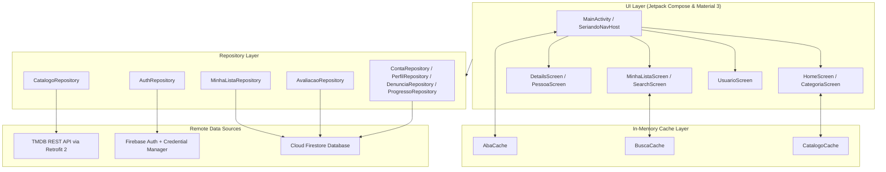
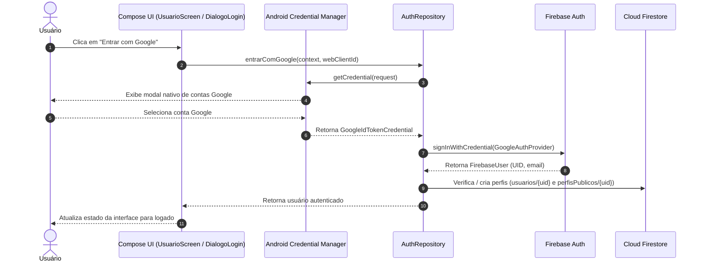

# 📺 Seriando

Aplicativo Android moderno e intuitivo para organizar as séries e filmes que você assiste, avaliar, comentar e acompanhar junto à comunidade. Pesquise títulos, acompanhe temporadas e episódios, veja a disponibilidade nos serviços de streaming, explore a biografia e filmografia de atores/atrizes e nunca mais perca onde parou.

Projeto desenvolvido em **Kotlin** com **Jetpack Compose**, seguindo boas práticas de arquitetura Android (MVVM / Repository Pattern), consumo de APIs REST com Retrofit, autenticação com Google Credential Manager API, persistência em nuvem com Cloud Firestore e gerenciamento de estado resiliente.

---

## 📌 Versão Atual

**Versão: V0.12** *(em desenvolvimento — rumo à V1.0)*

### 🆕 Novidades da V0.12
- **Identidade Visual & Design System Velvet Purple (RNF10)**: Implementação do tema exclusivo da marca com paleta em tons de roxo veludo (`VelvetPurple`), fundo `Midnight` e superfícies `VelvetSurface`. Padronização do acabamento das capas de filmes e séries com cantos arredondados e borda sutil em lilás brilhante via `Modifier.capaDeObra()`, além do novo ícone oficial adaptativo do aplicativo.
- **Home por Categorias (RF44, RF45, RF46)**: A Home passou a exibir fileiras horizontais para cada gênero (*Em alta*, *Ação*, *Comédia*, *Suspense*, *Drama*, *Ficção científica*, *Terror*, *Romance*, *Animação*, *Crime*, *Documentário* e *Família*), agrupando filmes e séries. Ao final de cada fileira, o cartão "Ver mais" abre a lista completa da categoria em grade paginada (3 colunas) com o botão "Carregar mais".
- **Regras de Segurança do Firestore (RNF01, RNF03, RNF04)**: As regras de produção (`firestore.rules`) foram consolidadas, restringindo a leitura e escrita aos dados do próprio usuário, validando tipos/tamanhos de campos e garantindo que cada usuário vote apenas uma vez em cada opinião (sem votar na própria opinião).
- **Opinião Privada Isolada (RF48, RN12)**: As opiniões privadas foram movidas para um local de armazenamento exclusivo do autor (`usuarios/{uid}/opinioesPrivadas`), garantindo privacidade a nível de banco de dados e não apenas ocultação na UI.
- **Tratamento de Erros e Carregamento**: Todas as telas exibem indicadores de carregamento e mensagens explicativas em caso de falha de rede ou permissão, com ação de tentar novamente sem causar travamentos ou crashes no aplicativo.
- **Exclusão de Conta e Direitos LGPD (RF29)**: Funcionalidade completa para exclusão permanente da conta e de todos os dados associados no Firestore em lotes seguros e idempotentes (até 400 documentos por lote), exigindo confirmação de identidade prévia via Credential Manager API.
- **Documentação Estruturada de Requisitos**: Adição do levantamento completo de requisitos funcionais e não funcionais, regras de negocio e pipeline de publicação no diretório [`docs/requisitos-seriando.md`](file:///C:/Users/Lucas/AndroidStudioProjects/Seriando/docs/requisitos-seriando.md).

---

## 📖 Sobre o Projeto

O **Seriando** foi concebido para oferecer uma experiência completa de organização e descoberta de mídia para cinéfilos e maratonadores. Utilizando a API pública do **TMDB (The Movie Database)**, o aplicativo disponibiliza metadados atualizados de filmes, séries, temporadas, episódios, atores e onde assistir via **JustWatch**.

Integrado ao **Firebase Authentication (Google Sign-In)** e **Cloud Firestore**, o Seriando permite sincronizar em tempo real a lista pessoal de acompanhamento, progresso de episódios, avaliações numéricas (1 a 5 estrelas), resenhas públicas ou privadas com tags emocionais, interações de curtir/descurtir e denúncia de conteúdos impróprios.

---

## 🎨 Identidade Visual & Design System

O Seriando possui uma identidade visual única desenvolvida sob o conceito **Velvet Purple**, focada em legibilidade, imersão e elegância no modo escuro (tema nativo principal do app):

| Elemento | Cor / Valor Hex | Função na Interface |
| :--- | :--- | :--- |
| **Velvet Purple** | `#A98AF5` | Cor primária da marca: ícones ativos, botões de ação e barra de progresso |
| **Midnight** | `#17151F` | Fundo principal da aplicação |
| **Velvet Surface** | `#282333` | Superfície de elevação para cartões, caixas de diálogo e campos de entrada |
| **Lilás Brilhante** | `#C7ADFF` | Contorno fino de 1dp/2dp ao redor de capas de filmes e séries |
| **Texto Principal** | `#F7F5FC` | Títulos e textos de alta relevância (Contraste 6,6:1) |
| **Texto Secundário** | `#C9C4D3` | Sinopses, rótulos e informações secundárias |

### Componentes de Design (`Formas.kt` & `Theme.kt`)

- **Modificador Reutilizável `Modifier.capaDeObra()`**: Padroniza todas as capas do aplicativo aplicando cantos arredondados de 8dp (`FormaCapa`) e uma borda de destaque em `LilasBrilhante`, garantindo consistência visual em todas as telas (Home, Busca, Detalhes, Minha Lista e Artistas).
- **Contraste e Acessibilidade Calibrados**: O texto do botão sobre `VelvetPurple` utiliza a cor `Midnight` em vez de branco, alcançando razão de contraste de 6,6:1 (em conformidade com as diretrizes WCAG AA).
- **Tema Claro Derivado**: Suporte ao tema claro com primária em `#6B47C7` para manter alto contraste e visibilidade em ambientes muito iluminados.

---

## 🏛️ Arquitetura & Padrões de Projeto

O aplicativo adota a **Clean Architecture** aliada ao **Repository Pattern** e princípios do **Android Jetpack**:



### Principais Componentes de Arquitetura

- **UI Declarativa**: Interface de usuário reativa desenvolvida com **Jetpack Compose** e componentes **Material Design 3**.
- **Gerenciamento de Estado & Cache em Memória**:
  - `AbaCache`: Preserva a aba ativa do `MainScaffold` durante a navegação em pilha.
  - `BuscaCache`: Mantém os termos e resultados de pesquisa ativos, evitando requisições desnecessárias.
  - `CatalogoCache`: Armazena em cache a primeira página de cada categoria da Home, eliminando recomposições e estados de carregamento ao retornar de telas filhas.
- **Camada de Dados Abstrata**: Repositórios desacoplados gerenciando a origem dos dados (TMDB REST API vs. Cloud Firestore):
  - `AuthRepository`: Fluxo de autenticação Google Sign-In e sessão do usuário.
  - `CatalogoRepository`: Consulta de obras em alta, por gênero, detalhes de mídias, temporadas e artistas.
  - `MinhaListaRepository`: Gerenciamento do acompanhamento pessoal sincronizado no Firestore.
  - `AvaliacaoRepository`: Críticas públicas e privadas, notas numéricas, reações emocionais e sistema de votos.
  - `ContaRepository`: Exclusão de conta com limpeza em lote (batching) em conformidade com a LGPD.
  - `DenunciaRepository`: Envio e registro de denúncias de conteúdos impróprios.
  - `PerfilRepository`: Gerenciamento de apelidos e escolha de avatares.
  - `ProgressoRepository`: Marcação granular de episódios e temporadas assistidas.

---

## 🔐 Autenticação & Fluxo de Segurança

O fluxo de login utiliza a **Android Credential Manager API** combinada com o **Firebase Authentication** para proporcionar autenticação sem fricção com Google Sign-In:



> [!IMPORTANT]
> **Confirmação de Identidade para Exclusão de Conta (LGPD / RF29)**: Para executar ações sensíveis, como a exclusão definitiva da conta, o aplicativo solicita a reautenticação através do Credential Manager antes de realizar a exclusão em lote no Cloud Firestore.

---

## 🗄️ Modelo de Dados & Schema do Firestore

O Cloud Firestore utiliza a seguinte estrutura relacional de coleções e subcoleções regidas pelo arquivo de segurança `firestore.rules`:

| Coleção / Caminho | Permissão de Leitura | Permissão de Escrita | Descrição & Campos Principais |
| :--- | :--- | :--- | :--- |
| `usuarios/{uid}` | Dono (`request.auth.uid == uid`) | Dono | Dados privados do usuário (`email`, `aniversario`). |
| `usuarios/{uid}/series/{serieId}` | Dono | Dono | Itens da lista pessoal (`id`, `nome`, `sinopse`, `caminhoCapa`, `tipoMidia`, `status`, `dataAdicao`). |
| `usuarios/{uid}/series/{serieId}/episodiosAssistidos/{docId}` | Dono | Dono | Progresso individual de episódios assistidos pelo usuário. |
| `usuarios/{uid}/opinioesPrivadas/{obraId}` | Dono | Dono | Críticas e anotações privadas do autor (`texto`, `spoiler`, `emocoes`, `data`). |
| `perfisPublicos/{uid}` | Usuários autenticados | Dono | Informações públicas de perfil (`apelido`, `avatarId`). |
| `avaliacoes/{obraId}/opinioes/{autorUid}` | Usuários autenticados | Dono | Resenhas públicas e notas de 1 a 5 estrelas (`nota`, `texto`, `spoiler`, `emocoes`, `apelidoAutor`, `avatarAutor`, `data`). |
| `avaliacoes/{obraId}/opinioes/{autorUid}/votos/{votanteUid}` | Usuários autenticados | Dono do voto (`votanteUid != autorUid`) | Controle de curtidas (+1) e descurtidas (-1) em opiniões da comunidade. |
| `denuncias/{id}` | Nenhuma (somente Admin Console) | Usuários autenticados | Registro de denúncias de conteúdos (`autorOpiniaoUid`, `tipoMidia`, `tmdbId`, `denuncianteUid`, `motivo`, `data`). |

---

## 🌐 Integração com TMDB API

A comunicação remota com a API da TMDB é intermediada pela interface `TmdbApiService` via Retrofit 2:

| Endpoint TMDB | Método HTTP | Função no App | Requisito Relacionado |
| :--- | :--- | :--- | :--- |
| `/trending/all/week` | `GET` | Busca obras populares da semana para a fileira "Em Alta" e o carrossel de destaques | **RF45** |
| `/discover/movie` | `GET` | Descobre filmes ordenados por popularidade filtrados por ID de gênero | **RF44** |
| `/discover/tv` | `GET` | Descobre séries ordenadas por popularidade filtradas por ID de gênero | **RF44** |
| `/search/multi` | `GET` | Pesquisa unificada de filmes, séries e pessoas com consulta textual | **RF03** |
| `/movie/{id}` | `GET` | Obtém detalhes completos de um filme (com elenco e vídeos via `append_to_response`) | **RF05** |
| `/tv/{id}` | `GET` | Obtém detalhes completos de uma série (com elenco e vídeos via `append_to_response`) | **RF05** |
| `/tv/{id}/season/{season_number}` | `GET` | Lista todos os episódios de uma temporada específica de uma série | **RF06** |
| `/movie/{id}/watch/providers` | `GET` | Provedores de streaming para assistir ao filme no Brasil (JustWatch) | **RF34** |
| `/tv/{id}/watch/providers` | `GET` | Provedores de streaming para assistir à série no Brasil (JustWatch) | **RF34** |
| `/person/{id}` | `GET` | Detalhes biográficos e foto de perfil de um ator/atriz | **RF41** |
| `/person/{id}/combined_credits` | `GET` | Filmografia completa (filmes e séries) de um artista | **RF42** |

---

## 🚀 Funcionalidades Principais

### 🔍 Navegação & Busca
- **Home em Seções**: Fileiras horizontais organizadas por gênero (incluindo o carrossel *Em alta* da semana) com navegação rápida para a visualização expandida de categorias (`CategoriaScreen`).
- **Busca Unificada**: Pesquisa integrada para filmes e séries utilizando o endpoint `/search/multi` do TMDB.
- **Navegação Resiliente**: Preservação do histórico de busca, termo digitado e posição de scroll ao avançar e retornar entre telas.

### 🎬 Detalhes da Obra & Mídia
- **Informações Detalhadas**: Pôster em alta resolução, nota média global, sinopse, ano de lançamento, elenco principal interativo e trailer oficial integrado do YouTube.
- **Gerenciamento de Temporadas e Episódios**:
  - Navegação entre temporadas com suporte a thumbnails individuais por episódio.
  - Marcação granular de episódios ou temporadas inteiras como assistidas.
  - Indicador visual de progresso (porcentagem de episódios concluídos).
- **Onde Assistir (JustWatch)**: Mapeamento de provedores de streaming disponíveis no Brasil para assinatura, aluguel ou compra.

### 🎭 Perfil de Artista (Atores/Atrizes)
- **Ficha do Artista**: Exibição de foto de perfil, nome completo, data e local de nascimento.
- **Biografia Adaptativa**: Exibição da biografia em português ou fallback automático para a versão em inglês na ausência de tradução.
- **Filmografia Interativa**: Grade com até 60 produções populares do ator/atriz, permitindo navegação direta para os detalhes de qualquer obra.

### 👤 Autenticação & Perfil de Usuário
- **Login Seguro via Google**: Integração do Firebase Auth com **Android Credential Manager API**.
- **Perfil Personalizado**: Apelido configurável, e-mail vinculado e seleção de avatar (foto da conta Google ou emojis divertidos).
- **Diálogo de Ação Protegida**: Exibição suave de modal de login ao tentar executar ações interativas sem autenticação.
- **Exclusão de Conta (LGPD / RF29)**: Exclusão definitiva e segura de todos os dados do usuário em lotes idempotentes, exigindo confirmação com biometria/passkey via Credential Manager.

### 📋 Minha Lista Pessoal
- **Sincronização em Nuvem**: Mídia salva no Cloud Firestore acessível de qualquer dispositivo.
- **Status Customizado**:
  - *Séries*: Assistindo, Quero Assistir, Pausado, Finalizado, Abandonado.
  - *Filmes*: Quero Assistir, Já Assisti, Abandonado.
- **Filtros Dinâmicos**: Filtragem instantânea por status de acompanhamento.

### ⭐ Comunidade & Avaliações
- **Sistema de Notas**: Avaliação de 1 a 5 estrelas com recálculo da média da comunidade em tempo real.
- **Opiniões Públicas e Privadas**: Publicação de críticas com tag de *spoiler* e seleção de até 6 emoções acompanhadas de ícones e cores temáticas.
- **Votação em Comentários**: Sistema de curtidas (+1) e descurtidas (-1) com trava contra múltiplos votos ou votos na própria publicação.
- **Canal de Denúncia**: Formulário para reporte de violações de conduta (conteúdo ofensivo, spoiler, spam, etc.).

---

## 📄 Documentação Adicional de Requisitos

A especificação técnica detalhada do projeto encontra-se disponível no diretório `docs/`:

- 📋 [**Levantamento Completo de Requisitos (`requisitos-seriando.md`)**](/Seriando/docs/requisitos-seriando.md):
  - **Requisitos Funcionais (RF01 a RF62)**: Detalhamento dos blocos implementados e em desenvolvimento.
  - **Requisitos Não Funcionais (RNF01 a RNF12)**: Segurança, LGPD, portabilidade para Compose Multiplatform e regras de banco.
  - **Regras de Negócio (RN01 a RN25)**: Comportamento das avaliações, pontuação, privacidade e concorrência.
  - **Análise de Risco & Segurança**: Modelo de ameaças STRIDE e checklist OWASP MASVS.
  - **Esteira de Publicação**: Procedimento de envio para Google Play Store e preparação para Apple App Store.

---

## 🛠️ Tecnologias & Bibliotecas

| Categoria | Tecnologia / Biblioteca | Versão / Uso |
| :--- | :--- | :--- |
| **Linguagem** | Kotlin | 2.0+ |
| **UI Framework** | Jetpack Compose | Material Design 3 |
| **Navegação** | Navigation Compose | Grafo de navegação centralizado (`navigation-compose:2.8.4`) |
| **Rede & HTTP** | Retrofit 2 + Gson + OkHttp 4 | Consumo das APIs do TMDB (`retrofit:2.11.0`) |
| **Imagens** | Coil 3 | Carregamento assíncrono e cache de imagens (`coil-compose:3.0.4`) |
| **Autenticação** | Firebase Auth + Credential Manager API | Google Sign-In e Passkeys (`credentials:1.3.0`) |
| **Banco de Dados** | Cloud Firestore | Armazenamento noSQL relacional (`firebase-firestore`) |
| **Build System** | Gradle | Kotlin DSL & Version Catalogs (`libs.versions.toml`) |

---

## 📂 Estrutura do Projeto

```
com.seriando.app
│
├── docs/              # Documentação de Requisitos, Regras de Negócio e Publicação
│   └── requisitos-seriando.md
│
├── data/
│   ├── auth/          # AuthRepository (Firebase Auth + Credential Manager + Sessão)
│   ├── cache/         # AbaCache, BuscaCache e CatalogoCache (Singletons de cache em memória)
│   ├── remote/        # RetrofitInstance e TmdbApiService (End-points e clientes HTTP)
│   └── repository/    # Repositórios (Avaliacao, Catalogo, Conta, Denuncia, MinhaLista, Perfil, Progresso)
│
├── model/             # Data Classes (Movie, Serie, Pessoa, Avaliacao, Categoria, Emocao, Status, etc.)
│
├── navigation/
│   ├── MainScaffold.kt # Scaffold principal com BottomNavigation (Home, Minha Lista, Conta)
│   ├── Rotas.kt        # Definição centralizada de caminhos e argumentos
│   └── SeriandoNavHost.kt # Grafo de navegação declarativo
│
├── ui/
│   ├── details/       # DetailsScreen, CartaoEpisodio, ElencoCard, OpiniaoCard, SecaoOndeAssistir, DialogoDenuncia
│   ├── home/          # HomeScreen, CategoriaRow, CategoriaScreen, DestaqueCard, ResultadoCard, DialogoEditarApelido
│   ├── login/         # DialogoLoginObrigatorio
│   ├── mylist/        # MinhaListaScreen (Lista filtrável por status)
│   ├── pessoa/        # PessoaScreen (Biografia, dados e filmografia do artista)
│   ├── search/        # SearchScreen (Pesquisa com suporte a cache)
│   ├── theme/         # Color.kt, Formas.kt (capaDeObra), Theme.kt, Type.kt (Design System Velvet Purple)
│   └── usuario/       # UsuarioScreen e SeletorAvatar
│
└── MainActivity.kt    # Ponto de entrada do aplicativo Android
```

---

## ⚙️ Instalação e Configuração

### Requisitos Prévios
- Android Studio Ladybug (2024.2.1) ou superior
- JDK 11 ou superior
- Dispositivo Android (Android 7.0 / API 24+) ou Emulador

### 1. Clonar o Repositório

```bash
git clone https://github.com/Lucksander/seriando.git
cd seriando
```

### 2. Configurar Chave da API TMDB

1. Crie uma conta gratuita em [The Movie Database (TMDB)](https://www.themoviedb.org/).
2. Em **Configurações da Conta > API**, gere sua Chave de API (*Developer API Key*).
3. Adicione a chave no arquivo `local.properties` na raiz do projeto:

```properties
TMDB_API_KEY=sua_chave_aqui_sem_aspas
```

> [!NOTE]
> O arquivo `local.properties` está incluído no `.gitignore` por razões de segurança. Durante a compilação, o Gradle lê essa variável e injeta em `BuildConfig.TMDB_API_KEY`.

### 3. Configurar o Firebase & Google Sign-In

1. Crie um projeto no [Firebase Console](https://console.firebase.google.com/).
2. Adicione um app Android com o nome do pacote `com.seriando.app`.
3. Registre a impressão digital SHA-1 do seu ambiente de desenvolvimento (`./gradlew signingReport`).
4. Baixe o arquivo `google-services.json` e coloque-o no diretório `app/` do projeto.
5. No Firebase Console:
   - Em **Authentication**, ative o método de login **Google**.
   - Em **Firestore Database**, instancie o banco de dados.
   - Em **Firestore Database > Regras**, cole o conteúdo do arquivo `firestore.rules` localizado na raiz do repositório e publique.
6. Localize o **Web Client ID** no `google-services.json` (dentro de `client_type: 3`) e adicione no arquivo `app/src/main/res/values/strings.xml`:

```xml
<resources>
    <string name="default_web_client_id">SEU_WEB_CLIENT_ID_AQUI</string>
</resources>
```

> [!WARNING]
> Certifique-se de que a impressão digital SHA-1 cadastrada no Firebase Console corresponde à chave de assinatura usada na compilação local ou de publicação. Caso contrário, o Google Sign-In retornará o erro `Developer Error (10)`.

### 4. Compilar e Executar

1. Abra o projeto no Android Studio.
2. Execute o Gradle Sync (*Sync Project with Gradle Files*).
3. Selecione um dispositivo e pressione **Run** (`Shift + F10`).

---

## 🧪 Testes e Qualidade de Código

O projeto conta com infraestrutura para testes unitários e testes instrumentados de interface.

### Executar Testes Unitários (JVM)

```bash
./gradlew testDebugUnitTest
```

Os testes unitários cobrem repositórios, lógica de negócios, parsing de modelos e manipuladores de status.

### Executar Testes Instrumentados de UI (Android)

```bash
./gradlew connectedDebugAndroidTest
```

> [!TIP]
> Certifique-se de ter um emulador Android ativo ou dispositivo físico conectado via ADB antes de rodar os testes instrumentados.

---

## ❓ Solução de Problemas (Troubleshooting)

<details>
<summary><b>1. Chave de API do TMDB inválida ou não encontrada</b></summary>

- **Sintoma**: As telas ficam em estado contínuo de carregamento ou exibem mensagem de erro ao buscar dados.
- **Solução**: Verifique se a chave `TMDB_API_KEY` foi corretamente definida no arquivo `local.properties` sem aspas. Após editar o arquivo, execute `Sync Project with Gradle Files` no Android Studio.
</details>

<details>
<summary><b>2. Erro de autenticação no Google Sign-In (Code 10 / Developer Error)</b></summary>

- **Sintoma**: O modal de login do Google fecha imediatamente após selecionar a conta.
- **Solução**:
  1. Execute `./gradlew signingReport` no terminal para obter a SHA-1 do ambiente.
  2. Adicione a SHA-1 nas configurações do aplicativo no Firebase Console.
  3. Baixe novamente o `google-services.json` atualizado.
  4. Verifique se o `default_web_client_id` em `strings.xml` corresponde ao Web Client ID de tipo 3 no Firebase.
</details>

<details>
<summary><b>3. Erro de permissão no Firestore (PERMISSION_DENIED)</b></summary>

- **Sintoma**: Falha ao salvar mídias na lista ou enviar avaliações.
- **Solução**: Certifique-se de publicar o arquivo `firestore.rules` atualizado no Firebase Console. Verifique se o usuário está autenticado antes de realizar operações de escrita.
</details>

---

## 📈 Histórico de Versões

- **V0.1**: Estrutura inicial do projeto em Jetpack Compose e configuração de versionamento.
- **V0.2**: Integração inicial com a API TMDB via Retrofit e pesquisa simples de séries com proteção de chave em `local.properties`.
- **V0.3**: Renderização de capas, sinopses e detalhes obtidos do TMDB com suporte a Coil.
- **V0.4**: Implementação do Navigation Compose, dividindo as telas em Home, Busca e Detalhes.
- **V0.5**: Integração com Firebase Authentication e Android Credential Manager API.
- **V0.6**: Conexão com Cloud Firestore para salvamento de itens na lista do usuário.
- **V0.7**: Navegação por abas com `MainScaffold`, carrossel de destaques na Home, busca unificada de filmes e séries, e marcação de episódios assistidos.
- **V0.8**: Diferenciação de status entre séries e filmes, nota do TMDB, elenco, trailers do YouTube, remoção de itens da lista e persistência do termo de busca.
- **V0.9**: Sistema de avaliação por estrelas (1 a 5), opiniões públicas e privadas com suporte a aviso de spoiler e tags emocionais.
- **V0.10**: Sistema de curtidas/descurtidas em comentários, denúncia de comentários e visualização de provedores de streaming ("Onde Assistir") via JustWatch.
- **V0.11**: Tela completa de atores/atrizes com foto, biografia expansível (fallback em inglês) e filmografia paginada por popularidade.
- **V0.12**: **(Versão Atual)** Home organizada por categorias de gênero com botão "Ver mais", lista paginada em grade de 3 colunas, regras de segurança estritas no Firestore, opiniões privadas em coleções isoladas, mensagens de erro resilientes, exclusão permanente de conta (RF29 / LGPD), Design System Velvet Purple com `Modifier.capaDeObra()` e documentação completa de requisitos em `docs/`.

---

## 📌 Planejamento Futuro (Roadmap V1.0)

- [x] **Home por Categorias**: Organização de títulos por gêneros cinematográficos com navegação expandida.
- [x] **Regras de Segurança do Firestore**: Consolidação de permissões rígidas no banco de dados.
- [x] **Tratamento Global de Erros**: Indicadores de carregamento, estados de falha e recuperação graciosa.
- [x] **Identidade Visual & Ícone**: Design System proprietário com paleta de cores Velvet Purple customizada e ícone exclusivo do app.
- [ ] **Testes Automatizados**: Expansão de testes unitários para repositórios/caches e testes de UI com Compose Testing.
- [ ] **Publicação na Google Play Store**.

---

## 🎯 Objetivos de Aprendizado

Este projeto serve como estudo prático e portfólio de desenvolvimento Android moderno:
- Criação de interfaces declarativas e reativas com **Jetpack Compose** e **Material 3**.
- Aplicação de arquitetura limpa (MVVM + Repository Pattern).
- Consumo de Web APIs RESTful com **Retrofit 2** e **Coroutines**.
- Integração com serviços de nuvem **Firebase** (Authentication e Firestore).
- Implementação da API **Android Credential Manager** para autenticação simplificada.
- Gerenciamento eficiente de estado e cache em memória.

---

## ⚠️ Avisos e Isenções de Responsabilidade

- Este projeto possui finalidade **estritamente educacional e não comercial**.
- Este produto utiliza a API do TMDB, mas não é endossado nem certificado pelo **TMDB (The Movie Database)**. Todos os metadados e imagens pertencem ao TMDB e aos seus respectivos detentores de direitos.
- Os dados de disponibilidade em serviços de streaming são fornecidos por **JustWatch**.

---

## 📄 Licença

Distribuído sob a licença **MIT**. Consulte o arquivo `LICENSE` para mais informações.

---

## 👨‍💻 Autores

- **Lucas Santos**
- **Erika Passos**
