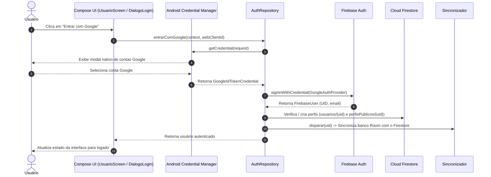
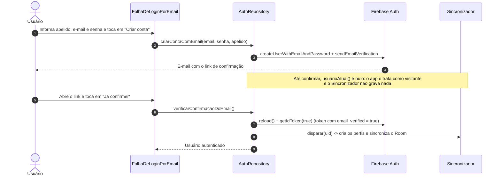
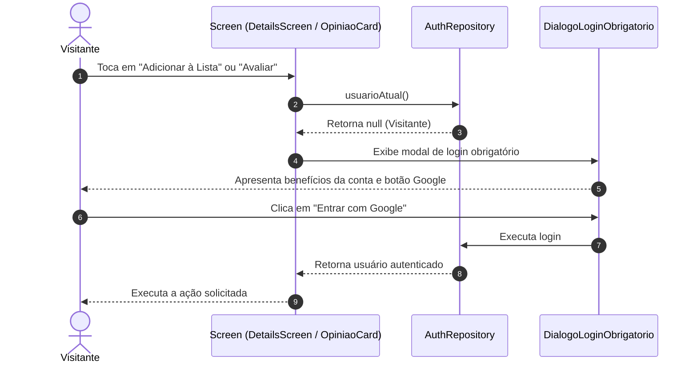

# 📺 Seriando

Aplicativo Android moderno e intuitivo para organizar as séries e filmes que você assiste, avaliar, comentar e acompanhar junto à comunidade. Pesquise títulos, acompanhe temporadas e episódios, veja a disponibilidade nos serviços de streaming, explore a biografia e filmografia de atores/atrizes e nunca mais perca onde parou.

Projeto desenvolvido em **Kotlin** com **Jetpack Compose**, seguindo boas práticas de arquitetura Android (MVVM / Repository Pattern), consumo de APIs REST com Retrofit, autenticação com Google Credential Manager API e com e-mail e senha (Firebase Authentication), persistência local com **Room Database (Offline-First)**, armazenamento de preferências com **DataStore**, sincronização em nuvem com Cloud Firestore e gerenciamento de estado resiliente.

---

## 📌 Versão Atual

**Versão: V1.0**

### 🆕 Novidades & Destaques da Versão

- **Login com e-mail e senha (`FolhaDeLoginPorEmail`, `ValidacaoDeConta`, `ErrosDeAuth`, RF32, RN33 a RN36, RNF18)**: alternativa ao Google, em uma folha inferior de quatro etapas (entrar, criar conta, aguardar a confirmação do e-mail e recuperar a senha). A conta só vale depois de o e-mail ser confirmado: até lá o app a trata como visitante (`AuthRepository.usuarioAtual()` devolve nulo) e as regras do Firestore exigem `email_verified`. Mensagens de erro neutras, que não revelam quais e-mails têm conta, e exclusão de conta com reautenticação por senha. Quem já usa Google continua entrando normalmente.
- **Foto de perfil própria só no aparelho (`FotoDePerfilLocal`, RF30, RN37)**: escolha pelo Photo Picker, recorte quadrado de 384 px e arquivo único na pasta interna do app, sem Firebase Storage e sem sincronização. Apagada no logout, na exclusão da conta e ao escolher outro avatar.
- **Minha Lista com busca, ordenação e filtros (`BarraDeBuscaDaLista`, `OrganizadorDaLista`, RF66)**: busca por nome sem diferenciar maiúsculas e acentos, ordem por data, nome ou status e chips fixos por status. Os status ganharam rótulos novos (séries: *Maratonei*; filmes: *Concluído*) e o *Abandonei* passou a existir também para filmes, sem mudar os valores gravados no Firestore.
- **Estatísticas na aba Conta (`CartaoDeEstatisticas`, RF67)**: cartão "Minha atividade" com filmes concluídos, séries maratonadas e episódios assistidos, contados do banco local.
- **Tema do app e novo visual (`ModoDoTema`, `CartaoDeAparencia`, RF80)**: seção Aparência na aba Conta (aparelho, claro ou escuro), guardada em DataStore, e paleta clara lilás mais viva.
- **Opinião com campo, emoções e spoiler renovados (`CampoDeOpiniao`, `SeletorEmocoes`, `MarcadorDeSpoiler`)**: campo arredondado no estilo da Home, seletor de emoções com animação de cor e marcador de spoiler em linha.
- **Recomendados para você (`FileiraDeRecomendacoes`, `Recomendacoes`, RF81, RN38)**: fileira no topo da Home com obras parecidas com as últimas séries e filmes que o usuário terminou, usando o endpoint de recomendações da TMDB. A lógica de escolha e combinação é pura e testada (`RecomendacoesTest`); obras já na lista não aparecem e o controle de idade vale.
- **Puxar para atualizar na Home (`PullToRefreshBox`, RF82)**: arrastar a Home para baixo recarrega categorias e recomendações, ignorando o cache.
- **Botão "Sair da conta" em destaque (`BotaoSair`, RF27, RN27)**: botão largo na aba Conta que sempre pede confirmação e avisa quando há alterações não sincronizadas.

- **Política de Privacidade & Termos de Uso dentro do app (`TextoLegalScreen`, `TextosLegais`, RF77)**: textos em conformidade com a LGPD guardados no código (funcionam sem internet e para o visitante), acessíveis pelas telas de introdução, pela tela de entrada e pela seção *Sobre* da aba Conta. Os mesmos textos estão em `docs/`.
- **Avatares em imagem (`AvatarDoUsuario`, `SeletorAvatar`, RF78)**: 15 avatares do app, escolhidos em uma folha inferior junto da foto da conta Google, no lugar dos antigos emojis.
- **Aba Conta reorganizada (`ComponentesDaConta`, RF79)**: perfil, classificação liberada, seção *Sobre* (Termos, Política e versão) e ações da conta (sair e excluir) em cartões.
- **Segurança & Testes (RNF16, RNF17)**: modelo de ameaças STRIDE e checklist OWASP MASVS verificados no código ([stride-seriando.md](docs/stride-seriando.md)), backup automático do Android desativado (`allowBackup="false"`), BoM do Firebase duplicado removido e testes unitários das regras de negócio (data de nascimento, controle de idade, classificação indicativa e status).
- **Controle de Idade & Classificação Indicativa do Brasil (`FiltroDeIdadeRepository`, `ControleDeIdade`, `ClassificacaoIndicativa`, RF49, RF50, RF51, RF59, RN13 a RN17)**: Sistema completo e centralizado de controle de idade e filtragem de conteúdo baseado na classificação indicativa brasileira (L, 10, 12, 14, 16 e 18 anos).
  - **Filtro Unificado na Camada de Dados ([FiltroDeIdadeRepository](file:///C:/Users/Lucas/AndroidStudioProjects/Seriando/app/src/main/java/com/seriando/app/data/repository/FiltroDeIdadeRepository.kt))**: Ponto único de decisão na camada de dados que oculta obras inadequadas na Home, categorias ("Ver mais"), busca, aba Descobrir e filmografia de artistas, sem duplicar regras de negócio na UI (RN15).
  - **Bloqueio da Tela de Detalhes ([ObraBloqueada](file:///C:/Users/Lucas/AndroidStudioProjects/Seriando/app/src/main/java/com/seriando/app/ui/details/ObraBloqueada.kt), RF51)**: Interceptação e bloqueio do acesso direto a obras acima da faixa etária permitida, exibindo o selo de classificação e mensagem orientativa.
  - **Seletor de Data de Nascimento & Trava de Correção Única ([DataNascimento](file:///C:/Users/Lucas/AndroidStudioProjects/Seriando/app/src/main/java/com/seriando/app/model/DataNascimento.kt), [SeletorDataNascimento](file:///C:/Users/Lucas/AndroidStudioProjects/Seriando/app/src/main/java/com/seriando/app/ui/usuario/SeletorDataNascimento.kt), RF59, RN17)**: Interface amigável com DatePicker do Material 3 na aba Conta, calculando a idade no momento do uso (RN13) e aplicando trava de segurança que aceita apenas uma correção pontual (`aniversarioAlterado` no Firestore e `aniversarioCorrigido` no Room).
  - **Proteção Padrão para Visitantes (RN14, RN16)**: Visitantes e usuários sem data informada são restritos automaticamente a conteúdos de até 12 anos. Obras sem classificação no Brasil exigem 18+ anos (RN14).
- **Melhorias na Tela de Detalhes (`InformacoesDaObra`, `CartaoTemporada`, RF73, RF74, RF75, RF76)**: Botão de compartilhar com o link da obra na TMDB (disponível também para visitantes), selo com a situação da obra segundo a TMDB, ano de lançamento (intervalo para séries, como "2019 – atual") e temporadas exibidas em cartões selecionáveis com barra de progresso dos episódios assistidos.
- **Apresentação & Onboarding de Boas-Vindas (`IntroducaoScreen`, RF52)**: Experiência de introdução em 3 páginas deslizáveis com animação radial e ícones temáticos (*O seu cantinho das séries*, *Saiba onde está passando*, *Compartilhe suas impressões*). Suporte a **Jetpack DataStore Preferences** ([PreferenciasApp](file:///C:/Users/Lucas/AndroidStudioProjects/Seriando/app/src/main/java/com/seriando/app/data/local/PreferenciasApp.kt)) para exibição única por instalação com opção de pular.
- **Tela de Entrada & Modo Visitante (`EntradaScreen`, `DialogoLoginObrigatorio`, RF53, RF54)**: Fluxo flexível para novos usuários permitindo explorar o catálogo, pesquisar títulos, consultar streaming e elenco como visitante sem obrigar o login inicial. Ao tentar executar ações restritas (salvar na lista, avaliar, opinar ou votar), exibe modal nativo ([DialogoLoginObrigatorio](file:///C:/Users/Lucas/AndroidStudioProjects/Seriando/app/src/main/java/com/seriando/app/ui/login/DialogoLoginObrigatorio.kt)) destacando os benefícios da conta.
- **Faixa de Conectividade & Monitor de Rede em Tempo Real (`ComFaixaDeConexao`, `MonitorConexao`, RF62)**: Injeção de banner persistente no topo do app alertando queda de conexão ("*Sem conexão. Você pode continuar usando o que está salvo no aparelho*"), contagem de pendências offline ("*N alterações ainda não sincronizadas*") e ação de envio forçado ("*Enviar agora*").
- **Aba Descobrir & Recomendações ("O que assistir hoje?") (`DescobrirScreen`, `DescobrirCache`, RF63, RF64, RF65)**: Aba dedicada de exploração com seletores combinados por tipo (Filmes/Séries), categorias TMDB e gêneros. Inclui paginação infinita em grade de 4 colunas, cache em memória persistente e o botão flutuante **"Sortear"** para sugestões aleatórias instantâneas.
- **Arquitetura Offline-First & Banco Local com Room (`SeriandoDatabase`, RF33, RNF11, RN21 a RN25)**: Infraestrutura relacional SQLite via Room Database com DAOs reativos ([ListaDao](file:///C:/Users/Lucas/AndroidStudioProjects/Seriando/app/src/main/java/com/seriando/app/data/local/Daos.kt), [EpisodioDao](file:///C:/Users/Lucas/AndroidStudioProjects/Seriando/app/src/main/java/com/seriando/app/data/local/Daos.kt), [PerfilDao](file:///C:/Users/Lucas/AndroidStudioProjects/Seriando/app/src/main/java/com/seriando/app/data/local/Daos.kt) e [ObraCacheDao](file:///C:/Users/Lucas/AndroidStudioProjects/Seriando/app/src/main/java/com/seriando/app/data/local/Daos.kt)), garantindo acesso contínuo aos dados pessoais mesmo offline.
- **Motor de Sincronização em Segundo Plano ([Sincronizador](file:///C:/Users/Lucas/AndroidStudioProjects/Seriando/app/src/main/java/com/seriando/app/data/sync/Sincronizador.kt))**: Sincronizador bidirecional e assíncrono entre o Room e o Cloud Firestore com tratamento de pendências (`pendenteSincronizacao`), exclusões lógicas (*tombstones*) e resolução de conflitos por *last-write-wins* (`atualizadoEm`, RN23).
- **Home por Categorias & Visão Expandida (`CategoriaRow`, `CategoriaScreen`, RF44, RF45, RF46, RF55, RF56)**: Organização da tela inicial em fileiras temáticas por gênero com botão e título clicáveis para visualização expandida em grade de 3 colunas.
- **Página do Artista & Filmografia (`PessoaScreen`, RF40, RF41, RF42, RF43)**: Detalhes completos de atores/atrizes, biografia expansível com suporte a idioma e filmografia interativa paginada por popularidade.
- **Histórico Local de Busca (`HistoricoBusca`)**: Armazenamento leve em `SharedPreferences` de termos pesquisados e obras recentemente visualizadas.

---

## 📖 Sobre o Projeto

O **Seriando** foi concebido para oferecer uma experiência completa de organização e descoberta de mídia para cinéfilos e maratonadores. Utilizando a API pública do **TMDB (The Movie Database)**, o aplicativo disponibiliza metadados atualizados de filmes, séries, temporadas, episódios, atores e onde assistir via **JustWatch**.

Integrado ao **Firebase Authentication (Google Sign-In)**, **Room Database**, **DataStore** e **Cloud Firestore**, o Seriando funciona de forma **Offline-First**, permitindo gerenciar e acompanhar seus títulos sem internet enquanto sincroniza em tempo real as listas, progresso de episódios, avaliações numéricas (1 a 5 estrelas), resenhas públicas ou privadas com tags emocionais, interações de curtir/descurtir e denúncias de conteúdos impróprios.

---

## 🎨 Identidade Visual & Design System

O Seriando possui uma identidade visual única desenvolvida sob o conceito **Velvet Purple**, focada em legibilidade, imersão e elegância no modo escuro (tema nativo principal do app):

| Elemento | Cor / Valor Hex | Função na Interface |
| :--- | :--- | :--- |
| **Velvet Purple** | `#A98AF5` | Cor primária da marca: ícones ativos, botões de ação e barra de progresso |
| **Midnight** | `#17151F` | Fundo principal da aplicação |
| **Velvet Surface** | `#282333` | Superfície de elevação para cartões, caixas de diálogo e campos de entrada |
| **Lilás Brilhante** | `#C7ADFF` | Contorno fino de 1dp/2dp ao redor de capas de filmes e séries |
| **Texto Principal** | `#F7F5FC` | Títulos e textos de alta relevância (Contraste 6,6:1) |
| **Texto Secundário** | `#C9C4D3` | Sinopses, rótulos e informações secundárias |

### Componentes de Design ([Formas.kt](file:///C:/Users/Lucas/AndroidStudioProjects/Seriando/app/src/main/java/com/seriando/app/ui/theme/Formas.kt) & [Theme.kt](file:///C:/Users/Lucas/AndroidStudioProjects/Seriando/app/src/main/java/com/seriando/app/ui/theme/Theme.kt))

- **Modificador Reutilizável `Modifier.capaDeObra()`**: Padroniza todas as capas do aplicativo aplicando cantos arredondados de 8dp (`FormaCapa`) e uma borda de destaque em `LilasBrilhante`, garantindo consistência visual em todas as telas (Home, Busca, Descobrir, Detalhes, Minha Lista e Artistas).
- **Contraste e Acessibilidade Calibrados**: O texto do botão sobre `VelvetPurple` utiliza a cor `Midnight` em vez de branco, alcançando razão de contraste de 6,6:1 (em conformidade com as diretrizes WCAG AA).
- **Tema Claro Vivo e Escolha do Tema (RF80)**: Tema claro lilás com primária em `#7C4DFF` e fundo `#F5EEFF`, mantendo alto contraste. O usuário escolhe entre aparelho, claro ou escuro na seção Aparência da aba Conta.

---

## 🏛️ Arquitetura & Padrões de Projeto

O aplicativo adota a **Clean Architecture** aliada ao **Repository Pattern**, arquitetura **Offline-First** e princípios do **Android Jetpack**:

```mermaid
flowchart TD
    subgraph UI ["UI Layer (Jetpack Compose & Material 3)"]
        A[MainActivity / SeriandoNavHost] --> INTRO[IntroducaoScreen]
        A --> ENT[EntradaScreen]
        A --> MAIN[MainScaffold]
        MAIN --> B[HomeScreen / CategoriaScreen]
        MAIN --> DESC[DescobrirScreen]
        MAIN --> D[MinhaListaScreen]
        MAIN --> USU[UsuarioScreen]
        A --> C[DetailsScreen / PessoaScreen]
        A --> S[SearchScreen]
        A --> BANNER[ComFaixaDeConexao]
    end

    subgraph Cache ["In-Memory & Local Preferences"]
        F[AbaCache]
        G[BuscaCache]
        H[CatalogoCache]
        DESC_CACHE[DescobrirCache]
        PREFS[PreferenciasApp DataStore]
        HIST[HistoricoBusca SharedPrefs]
    end

    subgraph Repositories ["Repository Layer"]
        I[AuthRepository]
        J[CatalogoRepository]
        K[MinhaListaRepository / ProgressoRepository]
        L[AvaliacaoRepository / PerfilRepository]
        M[ContaRepository / DenunciaRepository]
        CACHE_REPO[ObraCacheRepository]
    end

    subgraph LocalData ["Local Data Layer (Room / Offline-First)"]
        N[Dependencias] --> O[(Room Database: SeriandoDatabase)]
        O --> P[ListaDao / EpisodioDao / PerfilDao / ObraCacheDao]
    end

    subgraph NetworkSync ["Network & Synchronization Engine"]
        MONITOR[MonitorConexao]
        Q[Sincronizador]
    end

    subgraph RemoteDataSources ["Remote Data Sources"]
        R[TMDB REST API via Retrofit 2]
        S[Firebase Auth + Credential Manager]
        T[Cloud Firestore Database]
    end

    B <--> H
    S <--> G & HIST
    DESC <--> DESC_CACHE
    A <--> F
    INTRO <--> PREFS

    UI --> Repositories
    J --> R
    I --> S
    K & L --> P
    K & L --> Q
    CACHE_REPO <--> P
    MONITOR --> Q
    Q <--> P
    Q <--> T
    M --> T
```



### Principais Componentes de Arquitetura

- **UI Declarativa**: Interface de usuário reativa desenvolvida com **Jetpack Compose** e componentes **Material Design 3**.
- **Grafo de Navegação Reativo ([SeriandoNavHost.kt](file:///C:/Users/Lucas/AndroidStudioProjects/Seriando/app/src/main/java/com/seriando/app/navigation/SeriandoNavHost.kt))**: Decisão dinâmica de destino inicial ao abrir o app:
  - Usuário autenticado $\rightarrow$ [HomeScreen](file:///C:/Users/Lucas/AndroidStudioProjects/Seriando/app/src/main/java/com/seriando/app/ui/home/HomeScreen.kt)
  - Sem sessão & primeira abertura $\rightarrow$ [IntroducaoScreen](file:///C:/Users/Lucas/AndroidStudioProjects/Seriando/app/src/main/java/com/seriando/app/ui/introducao/IntroducaoScreen.kt)
  - Sem sessão & introdução vista $\rightarrow$ [EntradaScreen](file:///C:/Users/Lucas/AndroidStudioProjects/Seriando/app/src/main/java/com/seriando/app/ui/login/EntradaScreen.kt)
- **Persistência Local & Offline-First (Room Database)**:
  - `SeriandoDatabase`: Banco relacional local gerenciado pelo Room com suporte a migrações e transações atômicas (`emTransacao`).
  - `ListaDao`: Leitura reativa (`Flow`) e mutações pendentes na lista pessoal do usuário.
  - `EpisodioDao`: Acompanhamento de episódios e temporadas assistidas offline.
  - `PerfilDao`: Armazenamento local do perfil do usuário (`perfil`).
  - `ObraCacheDao`: Cache em disco em formato JSON das respostas do TMDB para obras salvas.
- **Motor de Sincronização em Segundo Plano ([Sincronizador.kt](file:///C:/Users/Lucas/AndroidStudioProjects/Seriando/app/src/main/java/com/seriando/app/data/sync/Sincronizador.kt))**:
  - Executa tarefas assíncronas em segundo plano (`Dispatchers.IO` + `SupervisorJob`) garantindo sincronização bidirecional transparente.
  - Resolve conflitos por estampa de tempo (*last-write-wins*, RN23), gerencia pendências de envio (`pendenteSincronizacao`) e trata exclusões com registros do tipo *tombstone* (`removido`).
- **Filtro de Conteúdo Centralizado ([FiltroDeIdadeRepository.kt](file:///C:/Users/Lucas/AndroidStudioProjects/Seriando/app/src/main/java/com/seriando/app/data/repository/FiltroDeIdadeRepository.kt))**: Centralização da lógica de controle de idade e verificação da classificação indicativa brasileira (TMDB `release_dates`/`content_ratings`), garantindo que mídias inadequadas sejam filtradas em uma única camada (RN15) e com cache em memória (RNF13).
- **Gerenciamento de Estado & Cache em Memória**:
  - `AbaCache`: Preserva a aba ativa do `MainScaffold` durante a navegação.
  - `BuscaCache`: Mantém termos e resultados de pesquisa ativos.
  - `CatalogoCache`: Armazena a primeira página de cada categoria da Home, evitando recomposições e chamadas repetidas.
  - `DescobrirCache`: Preserva filtros ativos, página atual e catálogo sorteado na aba Descobrir.
  - `VersaoDaIdade`: Sinaliza alterações na idade do usuário para invalidação e atualização reativa dos caches de listas.

---

## 🔐 Autenticação, Onboarding & Segurança

### Fluxo de Login com Credential Manager API



### Fluxo de Login com E-mail e Senha (RF32)



### Modo Visitante & Interceptação de Ações (RF54)

Para proporcionar uso sem barreiras, o Seriando permite navegação como visitante. Quando um visitante tenta executar ações que exigem identificação (adicionar à lista, marcar episódio, avaliar, opinar ou votar), a interface intercepta o toque e apresenta a folha de diálogo [DialogoLoginObrigatorio.kt](file:///C:/Users/Lucas/AndroidStudioProjects/Seriando/app/src/main/java/com/seriando/app/ui/login/DialogoLoginObrigatorio.kt):



> [!IMPORTANT]
> **Confirmação de Identidade para Exclusão de Conta (LGPD / RF29)**: Para executar ações sensíveis, como a exclusão definitiva da conta, o aplicativo solicita a reautenticação através do Credential Manager antes de realizar a exclusão em lote no Cloud Firestore e a limpeza do banco local (`Dependencias.limparBancoLocal()`).

---

## 🗄️ Modelo de Dados & Armazenamento Local / Nuvem

### Schema do Banco de Dados Local (Room Database)

O banco relacional local (`SeriandoDatabase`) armazena os dados da sessão ativa para suporte offline-first:

| Tabela Room | Chave Primária | Finalidade & Campos Principais | Requisito / Regra |
| :--- | :--- | :--- | :--- |
| `lista` | `id` (Int - TMDB) | Espelho local da lista pessoal (`id`, `nome`, `sinopse`, `caminhoCapa`, `tipoMidia`, `status`, `dataAdicao`, `atualizadoEm`, `pendenteSincronizacao`, `removido`). | **RF07, RF08, RN21, RN22** |
| `episodiosAssistidos` | `[serieId, temporada, numero]` | Registros de episódios assistidos (`serieId`, `temporada`, `numero`, `atualizadoEm`, `pendenteSincronizacao`, `removido`). | **RF09, RF10, RN20** |
| `perfil` | `uid` (String) | Consolidação dos perfis privado e público (`uid`, `apelido`, `avatarId`, `aniversario`, `aniversarioCorrigido`, `atualizadoEm`, `pendenteSincronizacao`). | **RF12, RF15, RF59, RN17, RNF08** |
| `obrasCache` | `[tipoMidia, tmdbId, parte]` | Cache local em JSON dos detalhes (`parte = -1`), de onde assistir (`parte = -2`) e das temporadas (`parte >= 0`) de obras da lista para navegação offline. | **RF33** |

### DataStore & SharedPreferences

| Mecanismo | Chave / Arquivo | Conteúdo & Utilidade |
| :--- | :--- | :--- |
| **DataStore Preferences** | `preferencias_app` / `introducao_vista` | Flag booleana indicando se a introdução de 3 telas já foi concluída ou pulada (RF52). |
| **SharedPreferences** | `historico_busca_prefs` | Histórico local com limite de 10 termos pesquisados recentemente e lista de obras visualizadas. |

### Schema do Cloud Firestore

O Cloud Firestore utiliza a seguinte estrutura relacional de coleções e subcoleções regidas pelo arquivo de segurança `firestore.rules`:

| Coleção / Caminho | Permissão de Leitura | Permissão de Escrita | Descrição & Campos Principais |
| :--- | :--- | :--- | :--- |
| `usuarios/{uid}` | Dono (`request.auth.uid == uid`) | Dono | Dados privados do usuário (`email`, `aniversario`, `aniversarioAlterado` com validação de correção única em `firestore.rules`). |
| `usuarios/{uid}/series/{serieId}` | Dono | Dono | Itens da lista pessoal (`id`, `nome`, `sinopse`, `caminhoCapa`, `tipoMidia`, `status`, `dataAdicao`, `atualizadoEm`). |
| `usuarios/{uid}/series/{serieId}/episodiosAssistidos/{docId}` | Dono | Dono | Progresso individual de episódios assistidos pelo usuário. |
| `usuarios/{uid}/opinioesPrivadas/{obraId}` | Dono | Dono | Críticas e anotações privadas do autor (`texto`, `spoiler`, `emocoes`, `data`). |
| `perfisPublicos/{uid}` | Usuários autenticados | Dono | Informações públicas de perfil (`apelido`, `avatarId`, `atualizadoEm`). |
| `avaliacoes/{obraId}/opinioes/{autorUid}` | Usuários autenticados | Dono | Resenhas públicas e notas de 1 a 5 estrelas (`nota`, `texto`, `spoiler`, `emocoes`, `apelidoAutor`, `avatarAutor`, `data`). |
| `avaliacoes/{obraId}/opinioes/{autorUid}/votos/{votanteUid}` | Usuários autenticados | Dono do voto (`votanteUid != autorUid`) | Controle de curtidas (+1) e descurtidas (-1) em opiniões da comunidade. |
| `denuncias/{id}` | Nenhuma (somente Admin Console) | Usuários autenticados | Registro de denúncias de conteúdos (`autorOpiniaoUid`, `tipoMidia`, `tmdbId`, `denuncianteUid`, `motivo`, `data`). |

---

## 🌐 Integração com TMDB API

A comunicação remota com a API da TMDB é intermediada pela interface [TmdbApiService.kt](file:///C:/Users/Lucas/AndroidStudioProjects/Seriando/app/src/main/java/com/seriando/app/data/remote/TmdbApiService.kt) via Retrofit 2:

| Endpoint TMDB | Método HTTP | Função no App | Requisito Relacionado |
| :--- | :--- | :--- | :--- |
| `/trending/all/week` | `GET` | Busca obras populares da semana para a fileira "Em Alta" e o carrossel de destaques | **RF45** |
| `/discover/movie` | `GET` | Descobre filmes por popularidade, lançamentos, notas ou gênero no Descobrir/Home | **RF44, RF63** |
| `/discover/tv` | `GET` | Descobre séries por popularidade, lançamentos, notas ou gênero no Descobrir/Home | **RF44, RF63** |
| `/search/multi` | `GET` | Pesquisa unificada de filmes, séries e pessoas com consulta textual | **RF03** |
| `/movie/{id}` | `GET` | Obtém detalhes completos de um filme (com elenco e vídeos via `append_to_response`) | **RF05** |
| `/tv/{id}` | `GET` | Obtém detalhes completos de uma série (com elenco e vídeos via `append_to_response`) | **RF05** |
| `/tv/{id}/season/{season_number}` | `GET` | Lista todos os episódios de uma temporada específica de uma série | **RF06** |
| `/movie/{id}/watch/providers` | `GET` | Provedores de streaming para assistir ao filme no Brasil (JustWatch) | **RF34** |
| `/tv/{id}/watch/providers` | `GET` | Provedores de streaming para assistir à série no Brasil (JustWatch) | **RF34** |
| `/person/{id}` | `GET` | Detalhes biográficos e foto de perfil de um ator/atriz | **RF41** |
| `/person/{id}/combined_credits` | `GET` | Filmografia completa (filmes e séries) de um artista | **RF42** |
| `/movie/{id}/release_dates` | `GET` | Certificações de lançamento por país para classificação indicativa do filme no Brasil (BR) | **RF49, RN14** |
| `/tv/{id}/content_ratings` | `GET` | Classificações indicativas por país para a série no Brasil (BR) | **RF49, RN14** |

---

## 🚀 Funcionalidades Principais

### 🔞 Controle de Idade & Classificação Indicativa (RF49, RF50, RF51, RF59, RN13 a RN17)
- **Classificação Indicativa Brasileira (L, 10, 12, 14, 16, 18)**: Consulta das certificações oficiais para o Brasil (BR) na TMDB para filmes (`release_dates`) e séries (`content_ratings`), selecionando a classificação mais restritiva em caso de múltiplos lançamentos no país (RF49, RN14).
- **Filtro Automático em Camada Única**: Centralização da filtragem no repositório ([FiltroDeIdadeRepository](file:///C:/Users/Lucas/AndroidStudioProjects/Seriando/app/src/main/java/com/seriando/app/data/repository/FiltroDeIdadeRepository.kt)), garantindo que obras inadequadas para a idade do usuário sejam ocultadas da Home, categorias ("Ver mais"), busca, aba Descobrir e filmografia de pessoas (RF50, RN15).
- **Bloqueio da Tela de Detalhes (`ObraBloqueada`)**: Interceptação de links ou acessos diretos a mídias com classificação acima da idade do usuário, substituindo a tela por mensagem orientativa e selo com as cores oficiais brasileiras (RF51).
- **Data de Nascimento & Trava de Segurança (RN17)**: Escolha de data no formato `AAAA-MM-DD` via DatePicker M3 ([SeletorDataNascimento](file:///C:/Users/Lucas/AndroidStudioProjects/Seriando/app/src/main/java/com/seriando/app/ui/usuario/SeletorDataNascimento.kt)), com cálculo dinâmico da idade sem armazená-la (RN13) e mecanismo no Firestore/Room que aceita no máximo 1 correção pontual em caso de erro de digitação (`aniversarioAlterado` no Firestore e `aniversarioCorrigido` no Room).
- **Modo Restrito para Visitantes e Desconectados**: Aplicação automática da faixa restrita de até 12 anos para visitantes e contas sem data de nascimento informada (RN16). Mídias sem classificação brasileira cadastrada exigem 18+ anos (RN14).
- **Invalidação Reativa de Cache (`VersaoDaIdade`)**: Notificação global em tempo de execução para reprocessar e recarregar os caches de listas no instante em que a idade do perfil muda ou ocorre troca de conta.

### 🌟 Introdução, Entrada & Modo Visitante (RF52, RF53, RF54)
- **Telas de Introdução (`IntroducaoScreen`)**: Carrossel deslizante em 3 etapas apresentando os diferenciais do app, memorizado em DataStore local (`PreferenciasApp`).
- **Tela de Entrada (`EntradaScreen`)**: Landing page com opções "Entrar com Google", "Entrar com e-mail" e "Continuar como visitante".
- **Interrupção Graciosa para Visitantes**: Permite explorar todo o aplicativo e exibe o modal [DialogoLoginObrigatorio](file:///C:/Users/Lucas/AndroidStudioProjects/Seriando/app/src/main/java/com/seriando/app/ui/login/DialogoLoginObrigatorio.kt) apenas ao solicitar uma ação que requer salvamento em conta.

### 📶 Faixa de Conectividade & Monitor de Rede (RF62)
- **Banner de Estado da Conexão (`ComFaixaDeConexao`)**: Alerta dinâmico na barra superior informando perda de rede ou existência de dados pendentes de sincronização offline.
- **Botão "Enviar Agora"**: Permite forçar o envio manual das pendências assim que a conexão for reestabelecida.

### 🧭 Aba Descobrir & Recomendações ("O que assistir hoje?") (RF63, RF64, RF65)
- **Filtros Combinados**: Seleção de Tipo (Filmes ou Séries), Catálogo TMDB (Populares, Bem avaliados, Em exibição, Próximos lançamentos, etc.) e Gênero cinematográfico.
- **Paginação Infinita & Grade de 4 Colunas**: Carregamento assíncrono e contínuo de novas páginas ao rolar até o final da lista.
- **Botão "Sortear" ("O que assistir hoje?")**: Sorteio instantâneo de uma obra aleatória com base nos filtros ativos para auxiliar na escolha do que assistir.
- **Cache Persistente (`DescobrirCache`)**: Preservação de filtros, paginação e resultados ao navegar para detalhes e retornar à aba.

### ⚡ Modo Offline-First & Sincronizador (RF33, RN21 a RN25)
- **Funcionamento Sem Internet**: Adição, remoção, alteração de status e acompanhamento de episódios salvos diretamente no banco de dados Room do dispositivo.
- **Sincronização Transparente**: Motor `Sincronizador` enviando e recebendo alterações em segundo plano na recuperação de conexão.
- **Resolução Automática de Conflitos**: Algoritmo *last-write-wins* por estampa de tempo (`atualizadoEm`), preservando sempre a versão mais recente dos dados.

### 📂 Home por Categorias & Navegação Expandida (RF44, RF45, RF46, RF55, RF56)
- **Fileiras Temáticas**: Categorias horizontais (*Em alta*, *Ação*, *Comédia*, *Suspense*, *Drama*, *Terror*, *Romance*, etc.) com rolagem suave.
- **Botão "Ver mais" & Título Clicável**: Acesso direto à tela [CategoriaScreen](file:///C:/Users/Lucas/AndroidStudioProjects/Seriando/app/src/main/java/com/seriando/app/ui/home/CategoriaScreen.kt) exibindo a lista completa paginada em grade de 3 colunas.

### 🎭 Perfil de Artista (Atores/Atrizes) (RF40, RF41, RF42, RF43)
- **Ficha do Artista**: Exibição de foto de perfil, nome completo, data e local de nascimento.
- **Biografia Adaptativa**: Exibição da biografia em português ou fallback automático para a versão em inglês na ausência de tradução.
- **Filmografia Interativa**: Grade com até 60 produções populares do ator/atriz, permitindo navegação direta para os detalhes de qualquer obra.

### 🎬 Detalhes da Obra, Progresso & Onde Assistir (RF05, RF06, RF09, RF10, RF34, RF47, RF57, RF73, RF74, RF75, RF76)
- **Informações Detalhadas**: Pôster em alta resolução, nota média global, sinopse, ano de lançamento, elenco principal interativo e trailer oficial integrado do YouTube.
- **Situação e Ano da Obra (RF74, RF75)**: Selo com a situação segundo a TMDB (séries: em exibição, finalizada, cancelada, em produção, planejada ou piloto; filmes: só quando ainda não lançado ou cancelado) e ano de lançamento, com intervalo para séries ("2019 – 2024" ou "2019 – atual").
- **Compartilhar (RF73)**: Botão ao lado do nome da obra que abre o menu de compartilhar do Android com uma mensagem e o link da página da obra na TMDB; disponível também para visitantes.
- **Gerenciamento de Temporadas e Episódios**:
  - Temporadas em cartões selecionáveis com nome, quantidade de episódios, ano e barra de progresso dos episódios assistidos (RF76).
  - Navegação entre temporadas com suporte a thumbnails individuais por episódio.
  - Marcação granular de episódios ou temporadas inteiras como assistidas.
  - Indicador visual de progresso (porcentagem de episódios concluídos).
- **Onde Assistir (JustWatch)**: Mapeamento de provedores de streaming disponíveis no Brasil para assinatura, aluguel ou compra.

### ⭐ Comunidade & Avaliações (RF16 a RF28, RF35, RF36, RF48)
- **Sistema de Notas**: Avaliação de 1 a 5 estrelas com recálculo da média da comunidade em tempo real.
- **Opiniões Públicas e Privadas**: Publicação de críticas com tag de *spoiler* e seleção de até 6 emoções acompanhadas de ícones e cores temáticas.
- **Votação em Comentários**: Sistema de curtidas (+1) e descurtidas (-1) com trava contra múltiplos votos ou votos na própria publicação.
- **Canal de Denúncia**: Formulário para reporte de violações de conduta (conteúdo ofensivo, spoiler, spam, etc.).

---

## 📄 Documentação Adicional de Requisitos

A especificação técnica detalhada do projeto encontra-se disponível no diretório `docs/`:

- 📋 [**Levantamento Completo de Requisitos (`requisitos-seriando.md`)**](file:///C:/Users/Lucas/AndroidStudioProjects/Seriando/docs/requisitos-seriando.md):
  - **Requisitos Funcionais (RF01 a RF79)**: Detalhamento dos blocos implementados e em desenvolvimento.
  - **Requisitos Não Funcionais (RNF01 a RNF15)**: Segurança, LGPD, portabilidade para Compose Multiplatform e regras de banco.
  - **Regras de Negócio (RN01 a RN32)**: Comportamento das avaliações, pontuação, privacidade, concorrência e sincronização offline.
  - **Análise de Risco & Segurança**: Modelo de ameaças STRIDE e checklist OWASP MASVS.
  - **Esteira de Publicação**: Procedimento de envio para Google Play Store e preparação para Apple App Store.
- 🏗️ **Arquitetura (`arquitetura.md`)**: camadas ui, data, model e navigation, modo offline e controle de idade.
- 🗄️ **Modelagem do Banco (`modelagem-banco.md`)**: coleções do Firestore, tabelas do Room e exemplos de leitura e escrita.
- 🔄 **Diagrama de Sequência (`diagrama-sequencia-sincronizacao.md`)**: alterações offline, volta da conexão e logout.
- 👥 **Casos de Uso (`casos-de-uso.md`)**: atores, diagrama e descrição de cada caso de uso.
- 📊 **Estudo de Viabilidade (`estudo-viabilidade.md`)**: pesquisa com 53 respostas que originou os requisitos.
- 🛡️ **Modelo de Ameaças (`stride-seriando.md`)**: análise STRIDE, checklist OWASP MASVS e recomendações priorizadas.
- 🔏 **Política de Privacidade (`politica-de-privacidade.md`) e Termos de Uso (`termos-de-uso.md`)**: os mesmos textos exibidos no app (LGPD).

---

## 🛠️ Tecnologias & Bibliotecas

| Categoria | Tecnologia / Biblioteca | Versão / Uso |
| :--- | :--- | :--- |
| **Linguagem** | Kotlin | 2.0+ |
| **UI Framework** | Jetpack Compose | Material Design 3 |
| **Navegação** | Navigation Compose | Grafo de navegação centralizado (`navigation-compose:2.8.4`) |
| **Banco Local** | Room Database | Biblioteca de persistência SQLite offline-first (`androidx.room:2.6.1`) |
| **Preferências** | Jetpack DataStore Preferences | Gravação assíncrona e reativa de preferências (`datastore-preferences:1.1.1`) |
| **Rede & HTTP** | Retrofit 2 + Gson + OkHttp 4 | Consumo das APIs do TMDB (`retrofit:2.11.0`) |
| **Imagens** | Coil 3 | Carregamento assíncrono e cache de imagens (`coil-compose:3.0.4`) |
| **Autenticação** | Firebase Auth + Credential Manager API | Google Sign-In e Passkeys (`credentials:1.3.0`) e login com e-mail e senha (Firebase Auth) |
| **Banco Nuvem** | Cloud Firestore | Armazenamento NoSQL relacional (`firebase-firestore`) |
| **Build System** | Gradle | Kotlin DSL & Version Catalogs (`libs.versions.toml`) |

---

## 📂 Estrutura do Projeto

```
com.seriando.app
│
├── docs/              # Documentação de Requisitos, Regras de Negócio e Publicação
│   ├── requisitos-seriando.md
│   ├── arquitetura.md
│   ├── modelagem-banco.md
│   ├── diagrama-sequencia-sincronizacao.md
│   ├── casos-de-uso.md
│   ├── estudo-viabilidade.md
│   ├── stride-seriando.md
│   ├── politica-de-privacidade.md
│   └── termos-de-uso.md
│
├── data/
│   ├── auth/          # AuthRepository (Firebase Auth + Credential Manager + Sessão)
│   ├── cache/         # Singletons de cache em memória (AbaCache, BuscaCache, CatalogoCache, DescobrirCache, VersaoDaIdade)
│   ├── local/         # Persistência local: SeriandoDatabase, DAOs (ListaDao, EpisodioDao, PerfilDao, ObraCacheDao),
│   │                  # Entidades, Mapeamentos, Dependencias, PreferenciasApp (DataStore) e HistoricoBusca (SharedPrefs)
│   ├── remote/        # RetrofitInstance e TmdbApiService (Endpoints e clientes HTTP)
│   ├── repository/    # Repositórios (Avaliacao, Catalogo, Conta, Denuncia, FiltroDeIdade, MinhaLista, ObraCache, Perfil, Progresso)
│   └── sync/          # Motor de sincronização: MonitorConexao e Sincronizador (Room <-> Firestore)
│
├── model/             # Data Classes (Movie, Serie, Pessoa, Avaliacao, Categoria, ClassificacaoIndicativa, ControleDeIdade, DataNascimento, Descobrir, Emocao, Status, etc.)
│
├── navigation/
│   ├── MainScaffold.kt # Scaffold principal com BottomNavigation (Home, Descobrir, Minha Lista, Conta)
│   ├── Rotas.kt        # Definição centralizada de caminhos e argumentos de rota
│   └── SeriandoNavHost.kt # Grafo de navegação reativo com decisões de início
│
├── ui/
│   ├── comum/         # Componentes compartilhados: BotaoSair, ComFaixaDeConexao, LogoSeriando, MensagemSemConexao
│   ├── descobrir/     # DescobrirScreen (Aba Descobrir com filtros, grade de 4 colunas e botão "Sortear")
│   ├── details/       # DetailsScreen, CartaoEpisodio, CartaoTemporada, DialogoDenuncia, ElencoCard, InformacoesDaObra, ObraBloqueada, OpiniaoCard, SecaoOndeAssistir, SeletorEmocoes, SeletorEstrelas
│   ├── home/          # HomeScreen, CategoriaRow, CategoriaScreen, DestaqueCard, ResultadoCard, DialogoEditarApelido, DialogoRemoverDaLista
│   ├── introducao/    # IntroducaoScreen (3 páginas de boas-vindas com animação radial)
│   ├── login/         # EntradaScreen, LoginComGoogle, FolhaDeLoginPorEmail, AvisoDeLoginNecessario, DialogoLoginObrigatorio
│   ├── mylist/        # MinhaListaScreen (filtros por status, busca e ordenação), BarraDeBuscaDaLista
│   ├── pessoa/        # PessoaScreen (Biografia, dados e filmografia do artista)
│   ├── search/        # SearchScreen (Pesquisa com suporte a histórico e cache)
│   ├── theme/         # Color.kt, CoresEmocao.kt, Formas.kt (capaDeObra), Theme.kt, Type.kt (Design System Velvet Purple)
│   └── usuario/       # UsuarioScreen, SeletorAvatar, SeletorDataNascimento, CartaoDeAparencia e CartaoDeEstatisticas
│
├── MainActivity.kt    # Ponto de entrada do Android com setup de Edge-to-Edge
└── SeriandoApp.kt     # Subclasse Application (Inicialização do Room e disparo automático de sincronização)
```

---

## ⚙️ Instalação e Configuração

### Requisitos Prévios
- Android Studio Ladybug (2024.2.1) ou superior
- JDK 11 ou superior
- Dispositivo Android (Android 7.0 / API 24+) ou Emulador

### 1. Clonar o Repositório

```bash
git clone https://github.com/Lucksander/seriando.git
cd seriando
```

### 2. Configurar Chave da API TMDB

1. Crie uma conta gratuita em [The Movie Database (TMDB)](https://www.themoviedb.org/).
2. Em **Configurações da Conta > API**, gere sua Chave de API (*Developer API Key*).
3. Adicione a chave no arquivo `local.properties` na raiz do projeto:

```properties
TMDB_API_KEY=sua_chave_aqui_sem_aspas
```

> [!NOTE]
> O arquivo `local.properties` está incluído no `.gitignore` por razões de segurança. Durante a compilação, o Gradle lê essa variável e injeta em `BuildConfig.TMDB_API_KEY`.

### 3. Configurar o Firebase & Google Sign-In

1. Crie um projeto no [Firebase Console](https://console.firebase.google.com/).
2. Adicione um app Android com o nome do pacote `com.seriando.app`.
3. Registre a impressão digital SHA-1 do seu ambiente de desenvolvimento (`./gradlew signingReport`).
4. Baixe o arquivo `google-services.json` e coloque-o no diretório `app/` do projeto.
5. No Firebase Console:
   - Em **Authentication**, ative os métodos de login **Google** e **E-mail/senha** (sem o link por e-mail).
   - Em **Firestore Database**, instancie o banco de dados.
   - Em **Firestore Database > Regras**, cole o conteúdo do arquivo `firestore.rules` localizado na raiz do repositório e publique.
6. Localize o **Web Client ID** no `google-services.json` (dentro de `client_type: 3`) e adicione no arquivo `app/src/main/res/values/strings.xml`:

```xml
<resources>
    <string name="default_web_client_id">SEU_WEB_CLIENT_ID_AQUI</string>
</resources>
```

> [!WARNING]
> Certifique-se de que a impressão digital SHA-1 cadastrada no Firebase Console corresponde à chave de assinatura usada na compilação local ou de publicação. Caso contrário, o Google Sign-In retornará o erro `Developer Error (10)`.

### 4. Compilar e Executar

1. Abra o projeto no Android Studio.
2. Execute o Gradle Sync (*Sync Project with Gradle Files*).
3. Selecione um dispositivo e pressione **Run** (`Shift + F10`).

---

## 🧪 Testes e Qualidade de Código

O projeto conta com testes unitários das regras de negócio (JVM, sem emulador) e testes instrumentados do banco local (Room).

### Executar Testes Unitários (JVM)

```bash
./gradlew testDebugUnitTest
```

Os testes unitários (`app/src/test/java/com/seriando/app/model/`) cobrem as regras puras do app: `DataNascimentoTest` (validação da data e cálculo da idade, RN13), `ControleDeIdadeTest` (idade efetiva e filtro por classificação, RN14 a RN16 e RN31), `ClassificacaoIndicativaTest` (leitura da classificação do Brasil nas respostas da TMDB, RF49) `StatusHelperTest` (status de séries e filmes, RF08), `OrganizadorDaListaTest` (busca e ordenação da Minha Lista, RF66), `ValidacaoDeContaTest` (e-mail, senha e apelido, RN34) `ErrosDeAuthTest` (mensagens neutras de erro, RN35) e `RecomendacoesTest` (recomendações da Home, RF81). Repositórios, telas e regras do Firestore ainda não têm testes automatizados.

### Executar Testes Instrumentados do Banco Room (Android)

Os testes do banco de dados local ([BancoLocalTest.kt](file:///C:/Users/Lucas/AndroidStudioProjects/Seriando/app/src/androidTest/java/com/seriando/app/data/local/BancoLocalTest.kt)) validam a persistência offline, transações e gerenciamento de marcações pendentes usando um banco em memória:

```bash
./gradlew connectedDebugAndroidTest
```

> [!TIP]
> Certifique-se de ter um emulador Android ativo ou dispositivo físico conectado via ADB antes de rodar os testes instrumentados.

---

## ❓ Solução de Problemas (Troubleshooting)

<details>
<summary><b>1. Chave de API do TMDB inválida ou não encontrada</b></summary>

- **Sintoma**: As telas ficam em estado contínuo de carregamento ou exibem mensagem de erro ao buscar dados.
- **Solução**: Verifique se a chave `TMDB_API_KEY` foi corretamente definida no arquivo `local.properties` sem aspas. Após editar o arquivo, execute `Sync Project with Gradle Files` no Android Studio.
</details>

<details>
<summary><b>2. Erro de autenticação no Google Sign-In (Code 10 / Developer Error)</b></summary>

- **Sintoma**: O modal de login do Google fecha imediatamente após selecionar a conta.
- **Solução**:
  1. Execute `./gradlew signingReport` no terminal para obter a SHA-1 do ambiente.
  2. Adicione a SHA-1 nas configurações do aplicativo no Firebase Console.
  3. Baixe novamente o `google-services.json` atualizado.
  4. Verifique se o `default_web_client_id` em `strings.xml` corresponde ao Web Client ID de tipo 3 no Firebase.
</details>

<details>
<summary><b>3. Erro de permissão no Firestore (PERMISSION_DENIED)</b></summary>

- **Sintoma**: Falha ao salvar mídias na lista ou enviar avaliações.
- **Solução**: Certifique-se de publicar o arquivo `firestore.rules` atualizado no Firebase Console. Verifique se o usuário está autenticado antes de realizar operações de escrita.
</details>

---

## 📈 Histórico de Versões

- **V0.1**: Estrutura inicial do projeto em Jetpack Compose e configuração de versionamento.
- **V0.2**: Integração inicial com a API TMDB via Retrofit e pesquisa simples de séries com proteção de chave em `local.properties`.
- **V0.3**: Renderização de capas, sinopses e detalhes obtidos do TMDB com suporte a Coil.
- **V0.4**: Implementação do Navigation Compose, dividindo as telas em Home, Busca e Detalhes.
- **V0.5**: Integração com Firebase Authentication e Android Credential Manager API.
- **V0.6**: Conexão com Cloud Firestore para salvamento de itens na lista do usuário.
- **V0.7**: Navegação por abas com `MainScaffold`, carrossel de destaques na Home, busca unificada de filmes e séries, e marcação de episódios assistidos.
- **V0.8**: Diferenciação de status entre séries e filmes, nota do TMDB, elenco, trailers do YouTube, remoção de itens da lista e persistência do termo de busca.
- **V0.9**: Sistema de avaliação por estrelas (1 a 5), opiniões públicas e privadas com suporte a aviso de spoiler e tags emocionais.
- **V0.10**: Sistema de curtidas/descurtidas em comentários, denúncia de comentários e visualização de provedores de streaming ("Onde Assistir") via JustWatch.
- **V0.11**: Tela completa de atores/atrizes com foto, biografia expansível (fallback em inglês) e filmografia paginada por popularidade.
- **V0.12**: Home organizada por categorias de gênero com botão "Ver mais", lista paginada em grade de 3 colunas, regras de segurança estritas no Firestore, opiniões privadas em coleções isoladas, exclusão permanente de conta (RF29 / LGPD), Design System Velvet Purple e documentação completa de requisitos.
- **V0.13**: Onboarding de apresentação com carrossel de 3 páginas (`IntroducaoScreen`), persistência via DataStore (`PreferenciasApp`), Tela de Entrada (`EntradaScreen`) e Modo Visitante interceptado por `DialogoLoginObrigatorio`. Faixa de status de conectividade em tempo real (`ComFaixaDeConexao`), nova Aba Descobrir (`DescobrirScreen`) com botão "Sortear", persistência offline completa com Room Database (`SeriandoDatabase`), motor de sincronização em segundo plano com Firestore (`Sincronizador`) e testes instrumentados ([BancoLocalTest](file:///C:/Users/Lucas/AndroidStudioProjects/Seriando/app/src/androidTest/java/com/seriando/app/data/local/BancoLocalTest.kt)).
- **V0.14**: Implementação completa do Controle de Idade e Classificação Indicativa do Brasil (Bloco K / RF49, RF50, RF51, RF59, RN13 a RN17), com o repositório centralizado [FiltroDeIdadeRepository](file:///C:/Users/Lucas/AndroidStudioProjects/Seriando/app/src/main/java/com/seriando/app/data/repository/FiltroDeIdadeRepository.kt), cálculo dinâmico de idade, selos visuais de classificação indicativa (L, 10, 12, 14, 16, 18), bloqueio de detalhes ([ObraBloqueada](file:///C:/Users/Lucas/AndroidStudioProjects/Seriando/app/src/main/java/com/seriando/app/ui/details/ObraBloqueada.kt)), seletor de data de nascimento com DatePicker M3 ([SeletorDataNascimento](file:///C:/Users/Lucas/AndroidStudioProjects/Seriando/app/src/main/java/com/seriando/app/ui/usuario/SeletorDataNascimento.kt)), trava de correção única no Firestore (`aniversarioAlterado`) e invalidação de cache em tempo de execução via `VersaoDaIdade`. Melhorias na tela de Detalhes: compartilhar (RF73), situação da obra (RF74), ano de lançamento (RF75) e temporadas em cartões com progresso (RF76).
- **V1.0**: **(Versão Atual)** Login com e-mail e senha (RF32), foto de perfil própria no aparelho (RF30), busca e ordenação na Minha Lista (RF66), estatísticas na aba Conta (RF67), escolha do tema (RF80), recomendações na Home (RF81), status renovados, 15 avatares, opinião com novo visual e botão de sair em destaque, além de Política de Privacidade (LGPD) e Termos de Uso dentro do app (RF77), avatares em imagem (RF78), aba Conta reorganizada em cartões (RF79), modelo de ameaças STRIDE e checklist OWASP MASVS (`docs/stride-seriando.md`), backup automático do Android desativado (RNF16), BoM do Firebase unificado, testes unitários das regras de negócio (RNF17) e documentação completa em `docs/`.

---

## 📌 Planejamento Futuro

- [x] **Home por Categorias**: Organização de títulos por gêneros cinematográficos com navegação expandida.
- [x] **Regras de Segurança do Firestore**: Consolidação de permissões rígidas no banco de dados.
- [x] **Tratamento Global de Erros**: Indicadores de carregamento, estados de falha e recuperação graciosa.
- [x] **Identidade Visual & Ícone**: Design System proprietário com paleta de cores Velvet Purple customizada e ícone exclusivo do app.
- [x] **Modo Offline & Arquitetura Offline-First (Room)**: Persistência local reativa e sincronização bidirecional em segundo plano com o Firestore.
- [x] **Onboarding & Modo Visitante**: Introdução em 3 etapas, salvamento em DataStore e interceptação de login para visitantes.
- [x] **Aba Descobrir & Recomendações**: Filtros avançados com ordenação e botão "Sortear" (*"O que assistir hoje?"*).
- [x] **Controle de Idade e Classificação Indicativa (Bloco K)**: Filtro de conteúdo por idade e classificação indicativa no Brasil.
- [x] **Testes unitários das regras de negócio**: data de nascimento, controle de idade, classificação indicativa e status.
- [x] **Política de Privacidade, Termos de Uso e modelo de ameaças (STRIDE)**.
- [x] **Login com e-mail e senha, foto de perfil local, busca e ordenação da Minha Lista, estatísticas e escolha de tema** (RF32, RF30, RF66, RF67, RF80).
- [x] **Recomendações na Home** (RF81): fileira "Recomendados para você" a partir das obras terminadas.
- [ ] **Login com a conta Microsoft**: avaliado e adiado (esforço maior que o benefício neste momento).
- [ ] **Testes Automatizados (expansão)**: testes para repositórios/caches, regras do Firestore (emulador) e testes de UI com Compose Testing.
- [ ] **Publicação na Google Play Store**.

---

## 🎯 Objetivos de Aprendizado

Este projeto serve como estudo prático e portfólio de desenvolvimento Android moderno:
- Criação de interfaces declarativas e reativas com **Jetpack Compose** e **Material 3**.
- Aplicação de arquitetura limpa (MVVM + Repository Pattern).
- Arquitetura **Offline-First** com **Room Database**, DAOs reativos com Flow e sincronização de dados bidirecional com tratamento de conflitos.
- Armazenamento leve reativo de preferências locais com **Jetpack DataStore Preferences**.
- Consumo de Web APIs RESTful com **Retrofit 2** e **Coroutines**.
- Integração com serviços de nuvem **Firebase** (Authentication e Firestore).
- Implementação da API **Android Credential Manager** para autenticação simplificada.
- Gerenciamento eficiente de estado e cache em memória.

---

## ⚠️ Avisos e Isenções de Responsabilidade

- Este projeto possui finalidade **estritamente educacional e não comercial**.
- Este produto utiliza a API do TMDB, mas não é endossado nem certificado pelo **TMDB (The Movie Database)**. Todos os metadados e imagens pertencem ao TMDB e aos seus respectivos detentores de direitos.
- Os dados de disponibilidade em serviços de streaming são fornecidos por **JustWatch**.

---

## 📄 Licença

Distribuído sob a licença **MIT**. Consulte o arquivo `LICENSE` para mais informações.

---

## 👨‍💻 Autores

- **Lucas Santos**
- **Erika Passos**
