# Seriando — Diagrama de Arquitetura

## 1. Visão geral

O Seriando segue uma arquitetura em camadas, comum em apps Android modernos com Jetpack Compose: a camada de interface (UI) nunca fala diretamente com o Firebase ou com a TMDB — ela sempre passa pela camada de dados (Data), que isola os detalhes de cada serviço externo. Desde o Bloco N (modo offline), as telas da lista, do progresso e do perfil leem do banco local (Room) e a sincronização com o Firestore acontece em segundo plano (seção 5). Desde o Bloco K (controle de idade), todo catálogo vindo da TMDB passa por um filtro único na camada de dados (seção 6). A camada de modelo (Model) define as estruturas de dados usadas por todo o app.

```mermaid
graph TD
  subgraph UI["Camada UI (Jetpack Compose)"]
    Intro[IntroducaoScreen / EntradaScreen]
    Home[HomeScreen / CategoriaScreen]
    Descobrir[DescobrirScreen]
    Search[SearchScreen]
    Details[DetailsScreen / ObraBloqueada]
    MyList[MinhaListaScreen]
    Usuario[UsuarioScreen / SeletorDataNascimento]
    Pessoa[PessoaScreen]
    Legal["TextoLegalScreen (Termos e Política)"]
    LoginDialog[DialogoLoginObrigatorio]
    Faixa[ComFaixaDeConexao / BotaoSair]
  end

  subgraph Nav["Navegação"]
    NavHost[SeriandoNavHost + MainScaffold]
  end

  subgraph Data["Camada Data"]
    AuthRepo[AuthRepository]
    ContaRepo[ContaRepository]
    MinhaListaRepo[MinhaListaRepository]
    ProgressoRepo[ProgressoRepository]
    PerfilRepo[PerfilRepository]
    ObraCacheRepo[ObraCacheRepository]
    CatalogoRepo[CatalogoRepository]
    FiltroIdade[FiltroDeIdadeRepository]
    AvaliacaoRepo[AvaliacaoRepository]
    DenunciaRepo[DenunciaRepository]
    Retrofit[RetrofitInstance / TmdbApiService]
    Cache["BuscaCache / AbaCache / CatalogoCache / DescobrirCache (memória)"]
    Versao[VersaoDaIdade]
    Prefs["PreferenciasApp / HistoricoBusca (DataStore e SharedPreferences)"]
  end

  subgraph Offline["Modo offline (data/local e data/sync)"]
    Room[("Room: lista, episodiosAssistidos, perfil, obrasCache")]
    Sync[Sincronizador]
    Monitor[MonitorConexao]
  end

  subgraph Model["Camada Model"]
    Models["Serie, SerieDetalhe, Avaliacao, SerieSalva,
    StatusSerie, Emocao, PerfilPublico, PerfilPrivado,
    DataNascimento, ClassificacaoIndicativa, ControleDeIdade..."]
  end

  NavHost --> Intro
  NavHost --> Home
  NavHost --> Descobrir
  NavHost --> Search
  NavHost --> Details
  NavHost --> MyList
  NavHost --> Usuario
  NavHost --> Pessoa
  NavHost --> Legal

  Intro --> Prefs
  Intro --> AuthRepo
  Home --> AuthRepo
  Home --> PerfilRepo
  Home --> CatalogoRepo
  Descobrir --> CatalogoRepo
  Descobrir --> Cache
  Search --> Retrofit
  Search --> FiltroIdade
  Search --> Cache
  Search --> Prefs
  Pessoa --> FiltroIdade
  Details --> AuthRepo
  Details --> MinhaListaRepo
  Details --> ProgressoRepo
  Details --> AvaliacaoRepo
  Details --> PerfilRepo
  Details --> DenunciaRepo
  Details --> ObraCacheRepo
  Details --> FiltroIdade
  MyList --> MinhaListaRepo
  Usuario --> PerfilRepo
  Usuario --> AuthRepo
  Usuario --> ContaRepo
  LoginDialog --> AuthRepo
  Faixa --> Monitor
  Faixa --> Sync

  CatalogoRepo --> Retrofit
  CatalogoRepo --> Cache
  CatalogoRepo --> FiltroIdade
  ObraCacheRepo --> Retrofit
  FiltroIdade --> Retrofit
  FiltroIdade --> PerfilRepo

  Versao -->|idade mudou: recarregar| Home
  Versao -->|idade mudou: recarregar| Descobrir
  Versao -->|idade mudou: recarregar| Search
  Versao -->|idade mudou: recarregar| Details
  Versao -->|idade mudou: limpa| Cache
  AuthRepo -->|login e logout| Versao
  Sync -->|perfil veio da nuvem| Versao
  PerfilRepo -->|data salva| Versao

  MinhaListaRepo -->|lê e grava| Room
  ProgressoRepo -->|lê e grava| Room
  PerfilRepo -->|lê e grava| Room
  ObraCacheRepo -->|cópia das obras| Room
  MinhaListaRepo -->|pede envio| Sync
  ProgressoRepo -->|pede envio| Sync
  PerfilRepo -->|pede envio| Sync
  AuthRepo -->|login: sincroniza / logout: limpa| Sync
  AuthRepo -->|logout: limpa| Room
  Monitor -->|internet voltou| Sync
  Sync -->|envia e baixa| Room

  Data --> Model

  AuthRepo -->|Credential Manager| FirebaseAuth[("Firebase
  Authentication")]
  Sync --> Firestore[("Cloud
  Firestore")]
  AvaliacaoRepo --> Firestore
  DenunciaRepo --> Firestore
  ContaRepo --> Firestore
  Retrofit --> TMDB[("TMDB API")]
```

## 2. Descrição das camadas

### 2.1 UI (`ui/`)

Telas escritas como funções `@Composable`, organizadas por funcionalidade: `intro` (introdução e tela de entrada), `home`, `descobrir`, `search`, `details`, `mylist`, `usuario`, `login`, `legal`. Cada tela recebe funções de callback (ex: `aoClicarEmItem`) em vez de navegar sozinha — quem decide a navegação é sempre o `SeriandoNavHost`, nunca a tela em si. Essa separação permite testar e reutilizar os componentes de UI sem depender da navegação. Componentes de apoio da tela de Detalhes ficam em arquivos próprios: `InformacoesDaObra` (ano, situação da obra e selos de situação e de classificação), `CartaoTemporada` e `ObraBloqueada`; a aba Conta tem o `SeletorDataNascimento`, o `SeletorAvatar` (folha com as 15 imagens de avatar, a foto do Google e a foto própria do aparelho), o `AvatarDoUsuario` (mostra a foto, a imagem escolhida ou a inicial do apelido) e os cartões de seção de `ComponentesDaConta`. A pasta `legal` guarda a Política de Privacidade e os Termos de Uso como texto no código (`TextosLegais`), a tela que os exibe (`TextoLegalScreen`, com as rotas `termos` e `privacidade`) e o aviso com links usado na introdução e na tela de entrada (`AvisoDeTermosEPolitica`); funcionam sem internet e para o visitante (RF77).

### 2.2 Navegação (`navigation/`)

`Rotas.kt` centraliza os nomes das rotas. `SeriandoNavHost.kt` declara o grafo de navegação (quais telas existem e como se conectam), inclusive o fluxo de primeira abertura (introdução, depois entrada, depois o app). `MainScaffold.kt` implementa a navegação por abas (Home / Descobrir / Minha Lista / Conta) dentro da rota principal, com uma `NavigationBar` inferior.

### 2.3 Data (`data/`)

Dividida nas responsabilidades abaixo:

- **`remote/`** — `TmdbApiService` (interface Retrofit com os endpoints da TMDB, inclusive os de classificação indicativa e de descoberta) e `RetrofitInstance` (configuração única do cliente HTTP, com cache em disco de 10 MB, validade por tipo de endpoint e nova tentativa em erro 429; iniciada em `SeriandoApp`).
- **`auth/`** — `AuthRepository`, que isola o Firebase Authentication e o Credential Manager do resto do app e, no login e no logout, aciona a sincronização, a limpeza do banco local e a atualização da `VersaoDaIdade`. Cuida também do login com e-mail e senha (RF32): `usuarioAtual()` devolve nulo enquanto o e-mail não foi confirmado, e assim todo o app trata a conta como visitante (RN33). `ErrosDeAuth` traduz os códigos do Firebase em mensagens neutras (RN35). A foto de perfil própria (`FotoDePerfilLocal`, em `data/local`) é um arquivo no armazenamento interno, fora do Room e do Firestore (RN37).
- **`repository/`** — um repositório por área de dado. `MinhaListaRepository`, `ProgressoRepository` e `PerfilRepository` são offline-first: leem e gravam no Room e pedem a sincronização. `ObraCacheRepository` busca as respostas da TMDB e guarda uma cópia local. `CatalogoRepository` monta as categorias da Home e a grade da Descobrir. `FiltroDeIdadeRepository` aplica o controle de idade (seção 6). `AvaliacaoRepository`, `DenunciaRepository` e `ContaRepository` (exclusão de conta) falam direto com o Firestore, porque a comunidade exige conexão (RN24). O `AvaliacaoRepository` lê as opiniões em páginas e calcula a média por agregação no servidor (RN40); a `DenunciaRepository` grava a denúncia e a marca de ocultação num único lote (RF68). O `ObraCacheRepository` aplica a validade das cópias (RN39) e o `Sincronizador` recebe os episódios por diferença (RN41).

Por que essas escolhas: o custo por usuário é leituras por abertura × aberturas × usuários, e a cota do Firestore é única para todos. A justificativa completa, com números e cenários de crescimento, está em estrategia-de-requisicoes.md (RNF19).
- **`cache/`** — `BuscaCache`, `AbaCache`, `CatalogoCache` e `DescobrirCache`, estado em memória (não persistido) que sobrevive à navegação entre telas, para a pesquisa, a aba selecionada, as fileiras da Home e os filtros da Descobrir não "resetarem" ao voltar. `VersaoDaIdade` é um `StateFlow` que avisa as telas quando a idade do usuário muda e esvazia `CatalogoCache` e `BuscaCache` (RN32).
- **`local/`** — o banco local (Room): entidades, DAOs (interfaces), `SeriandoDatabase` e `Dependencias`, que entrega os DAOs aos repositórios sem que eles precisem de `Context` (RNF11). É a única pasta que conhece o Room.
- **`sync/`** — `Sincronizador`, que envia as alterações pendentes ao Firestore e baixa os dados da nuvem (inclusive a data de nascimento, avisando a `VersaoDaIdade`), e `MonitorConexao`, que informa se há internet e dispara a sincronização quando ela volta.
- **Preferências do aparelho** — `PreferenciasApp` (DataStore: indicação de "introdução já vista", RN30) e `HistoricoBusca` (SharedPreferences: pesquisas e obras vistas recentemente, RN29). Ficam só no aparelho e nunca vão ao Firestore.

### 2.4 Model (`model/`)

Classes de dados (`data class`) e enums que representam tanto as respostas da TMDB (`Serie`, `SerieDetalhe`, `MovieDetalhe`, `EpisodioResumo`, `ResultadoBusca`...) quanto os documentos salvos no Firestore (`SerieSalva`, `Avaliacao`, `PerfilPublico`, `PerfilPrivado`, `Denuncia`...). Também vivem aqui os conjuntos fixos usados pela regra de negócio, como `StatusSerie`, `StatusFilme` e `EMOCOES_DISPONIVEIS`, e as regras puras do controle de idade, sem dependência de Android: `DataNascimento` (texto `AAAA-MM-DD` e cálculo da idade), `ClassificacaoIndicativa` (L, 10, 12, 14, 16, 18 e "sem classificação") e `ControleDeIdade` (decide se uma classificação é permitida para uma idade).

## 3. Serviços externos

| Serviço | Função no app |
|---|---|
| **Firebase Authentication** | Login com Google via Credential Manager e com e-mail e senha (com confirmação do e-mail); mantém a sessão do usuário |
| **Cloud Firestore** | Banco de dados NoSQL: perfil, lista pessoal, progresso, avaliações, opiniões, votos e denúncias |
| **Room (SQLite local)** | Banco no aparelho: lista pessoal, progresso, perfil e cópia das obras. É de onde as telas leem (modo offline, RF33) e espelha o Firestore por meio do Sincronizador |
| **TMDB API** | Fonte de todos os dados de catálogo: busca, detalhes, elenco, vídeos, temporadas/episódios, classificação indicativa do Brasil, situação da obra e disponibilidade em streaming (via JustWatch) |

## 4. Padrão de injeção de dependência

O projeto não usa um framework de injeção de dependência (como Hilt ou Koin) — os repositórios são instanciados diretamente nas telas com `remember { XyzRepository() }`, o suficiente para o porte atual do app. Essa é uma simplificação consciente: documentada aqui para que a equipe saiba que a introdução de um framework de DI é uma evolução possível, não um requisito já atendido.

Os DAOs do Room chegam aos repositórios pelo objeto `Dependencias`, como parâmetros com valor padrão (`class MinhaListaRepository(private val local: ListaDao = Dependencias.listaDao)`). Por isso as telas continuam criando os repositórios sem argumentos, e os repositórios dependem só das interfaces dos DAOs, nunca do banco nem de `Context` (RNF11).

## 5. Modo offline (offline-first)

**Princípio (RN21):** a interface lê sempre do banco local. Toda alteração do usuário grava primeiro no Room, marcada como pendente, e só depois é enviada ao Firestore, em segundo plano. A tela nunca espera o Firestore: sem conexão, uma gravação nele só termina quando a internet volta.

**Campos de controle** das tabelas que o usuário altera (lista, episódios e perfil):

| Campo | Função |
|---|---|
| `pendenteSincronizacao` | `true` até a alteração ser confirmada na nuvem (RN22) |
| `atualizadoEm` | instante da alteração, em milissegundos; decide conflitos pela gravação mais recente (RN23) |
| `removido` (lista e episódios) | "lápide": o item some da tela na hora, mas fica no banco até a exclusão ser enviada à nuvem |
| `aniversarioCorrigido` (perfil) | `true` depois que o usuário usou a única correção da data de nascimento (RN17) |

**Quando o Sincronizador roda:** ao abrir o app e ao fazer login (envia as pendências e baixa tudo da nuvem), quando a internet volta (idem) e depois de cada alteração feita na tela (só envia, para poupar leituras do Firestore). Só uma rodada roda por vez, e sem internet ela nem começa.

**Conflitos (RN23):** antes de enviar, o Sincronizador confere o documento na nuvem. Se o `atualizadoEm` de lá for maior, a nuvem vence e a alteração local é descartada. Limitação conhecida: o instante vem do relógio do celular.

**Dados de outro usuário (RN25):** o banco local só guarda dados do usuário logado. É apagado no logout e na exclusão de conta, e o app registra de quem é o banco para apagá-lo se, por falha, ele sobrar para outro usuário.

**O que fica fora do banco local (RN24):** a comunidade (avaliações, opiniões, votos e médias) e o catálogo da Home, da Descobrir e da busca exigem conexão; o app avisa com uma faixa no topo e mensagens com o botão "Tentar de novo" (RF62).

**Versão do banco:** o Room está na versão 1, sem migração. Qualquer mudança de schema (como o campo `aniversarioCorrigido`) exige desinstalar o app durante o desenvolvimento; antes de publicar na Play Store, uma migração passa a ser obrigatória, senão a atualização do app derruba o banco dos usuários.

Os diagramas de sequência da sincronização estão em `diagrama-sequencia-sincronizacao.md`.

## 6. Controle de idade (Bloco K)

**Objetivo:** esconder do usuário as obras cuja classificação indicativa do Brasil esteja acima da idade dele (RF50, RF51) e exibir a classificação nos detalhes (RF49).

**Idade efetiva (`FiltroDeIdadeRepository.idadeEfetiva`):** calculada na hora do uso, a partir da data de nascimento do perfil (RN13). Visitante, usuário sem data e usuário com data inválida valem 12 anos (RN16). A data é lida como texto `AAAA-MM-DD` com `Calendar`/`SimpleDateFormat`, sem `java.time`, porque o `minSdk` é 24.

**Origem da classificação:** filmes pelo endpoint `release_dates` e séries por `content_ratings`, ambos filtrados para o Brasil (BR). Nos detalhes a classificação vem na mesma chamada (`append_to_response`); nas listas há consultas próprias, com cache em memória e no máximo 10 consultas paralelas (semáforo), para não estourar o limite da TMDB.

**Regras de decisão (`ControleDeIdade`):** a obra aparece se a classificação for menor ou igual à idade efetiva. Sem classificação para o Brasil, só aparece para quem tem 18 anos ou mais (RN14). Se a consulta falhar, a obra é tratada como sem classificação (RN31).

**Ponto único de aplicação (RN15):** `FiltroDeIdadeRepository.filtrar` e `obraPermitida` são chamados pelos repositórios e telas que listam obras: categorias e "Em alta" (`CatalogoRepository`), Descobrir, busca, filmografia da pessoa e histórico de obras vistas. A tela de Detalhes consulta `obraPermitida` e, se a obra for proibida, mostra `ObraBloqueada` com o botão Voltar, mesmo quando aberta por outro caminho (RF51).

**Atualização quando a idade muda (RN32):** `VersaoDaIdade` é incrementada no login, no logout, ao salvar a data de nascimento e quando a data chega da nuvem pelo `Sincronizador`. Ao mudar, os caches em memória (`CatalogoCache`, `BuscaCache`) são esvaziados e Home, Busca, Descobrir e Detalhes recarregam.

**Trava da data (RN17):** a data pode ser informada e corrigida uma única vez. O controle fica no campo `aniversarioAlterado` do Firestore (validado nas regras de segurança) e no campo `aniversarioCorrigido` do Room.

**Limitações conhecidas:** a data de nascimento é informada pelo próprio usuário e não é verificada; o filtro vive no app, então um app adulterado ou chamadas diretas à TMDB o contornam. A aba Minha Lista ainda mostra obras acima da idade (a trava vale ao abrir os detalhes). Estes pontos são tratados no modelo de ameaças (STRIDE).
