# Seriando — Diagrama de Casos de Uso

## 1. Atores

- **Visitante** — qualquer pessoa usando o app, sem estar autenticada. Pode entrar pela opção "Continuar como visitante" (RF53, RF54); nesse modo é tratado como menor, com classificação restrita a até 12 anos (RN16, RN18).
- **Usuário autenticado** — logado com conta Google ou com e-mail e senha (com o e-mail já confirmado, RN33); herda tudo que o Visitante pode fazer, e ganha acesso às ações que exigem identificação.

## 2. Diagrama

```mermaid
graph LR
  Visitante((Visitante))
  Usuario((Usuário
  autenticado))
  Usuario --> Visitante

  Visitante --- UC25([Ver a introdução do app])
  Visitante --- UC26([Continuar como visitante])
  Visitante --- UC01([Pesquisar séries e filmes])
  Visitante --- UC30([Usar histórico de busca])
  Visitante --- UC27([Navegar pelas categorias da Home])
  Visitante --- UC28([Descobrir obras por filtros])
  Visitante --- UC29([Sortear o que assistir])
  Visitante --- UC02([Visualizar detalhes da obra])
  Visitante --- UC03([Visualizar temporadas e episódios])
  Visitante --- UC04([Ver elenco e trailer])
  Visitante --- UC31([Ver página do ator/atriz])
  Visitante --- UC05([Ver onde assistir - streaming BR])
  Visitante --- UC32([Ver classificação indicativa])
  Visitante --- UC33([Compartilhar obra])
  Visitante --- UC34([Ter obras ocultas ou bloqueadas por idade])
  Visitante --- UC06([Ver média de avaliações])
  Visitante --- UC07([Ver opiniões públicas da comunidade])
  Visitante --- UC08([Autenticar com Google])
  Visitante --- UC39([Entrar ou criar conta com e-mail e senha])
  Visitante --- UC40([Recuperar a senha])
  Visitante --- UC44([Escolher o tema do app])
  Visitante --- UC38([Ler a Política de Privacidade e os Termos de Uso])

  Usuario --- UC09([Adicionar/remover item da lista pessoal])
  Usuario --- UC10([Definir status de acompanhamento])
  Usuario --- UC11([Marcar episódios/temporadas assistidos])
  Usuario --- UC12([Acompanhar progresso da série])
  Usuario --- UC13([Editar apelido e avatar])
  Usuario --- UC14([Informar data de nascimento - privada])
  Usuario --- UC35([Corrigir a data de nascimento uma única vez])
  Usuario --- UC15([Avaliar com estrelas 1 a 5])
  Usuario --- UC16([Remover a própria avaliação])
  Usuario --- UC17([Escrever opinião com emoções])
  Usuario --- UC18([Marcar opinião como spoiler])
  Usuario --- UC19([Tornar opinião pública ou privada])
  Usuario --- UC20([Editar/remover a própria opinião])
  Usuario --- UC21([Curtir/descurtir opinião de outro usuário])
  Usuario --- UC22([Remover o próprio voto])
  Usuario --- UC23([Denunciar e ocultar opinião])
  Usuario --- UC24([Sair da conta])
  Usuario --- UC36([Excluir a conta])
  Usuario --- UC37([Usar o app offline e sincronizar])
  Usuario --- UC41([Escolher foto de perfil própria])
  Usuario --- UC42([Buscar e ordenar a Minha Lista])
  Usuario --- UC43([Ver estatísticas da atividade])
  Usuario --- UC45([Ver recomendações parecidas com o que assistiu])
```

## 3. Descrição textual por caso de uso

| ID | Caso de uso | Ator | Pré-condição | RF / RN relacionados |
|---|---|---|---|---|
| UC01 | Pesquisar séries e filmes | Visitante | — | RF03, RF71 |
| UC02 | Visualizar detalhes da obra (inclui ano de lançamento e situação da obra) | Visitante | Obra dentro da idade permitida (UC34) | RF05, RF74, RF75 |
| UC03 | Visualizar temporadas (cartões com progresso) e episódios (com imagem) | Visitante | A obra é uma série | RF06, RF47, RF57, RF76 |
| UC04 | Ver elenco e trailer | Visitante | TMDB possui esses dados para a obra | RF05 |
| UC05 | Ver onde assistir | Visitante | — | RF34, RN09, RNF09 |
| UC06 | Ver média de avaliações | Visitante com conta (a comunidade exige login, RN08) | Existe ao menos uma avaliação | RF18 |
| UC07 | Ver opiniões públicas (a do próprio usuário no topo, em páginas, com "Carregar mais opiniões") | Visitante com conta (idem) | Existe ao menos uma opinião pública | RF21, RN40 |
| UC08 | Autenticar com Google | Visitante | Conta Google disponível no dispositivo | RF01, RF53 |
| UC09 | Adicionar/remover da lista pessoal | Usuário autenticado | Logado | RF02, RF07, RN20 |
| UC10 | Definir status de acompanhamento | Usuário autenticado | Item já está na lista | RF08 |
| UC11 | Marcar episódios/temporadas assistidos | Usuário autenticado | Obra é uma série | RF09 |
| UC12 | Acompanhar progresso da série | Usuário autenticado | Obra é uma série | RF10, RF76 |
| UC13 | Editar apelido e avatar (foto da conta Google ou uma das 15 imagens do app) | Usuário autenticado | Logado | RF13, RF15, RF78, RF79 |
| UC14 | Informar data de nascimento (privada, usada só para calcular a idade) | Usuário autenticado | Logado | RF59 (substitui o RF14), RN13, RN16 |
| UC15 | Avaliar com estrelas | Usuário autenticado | Logado | RF16 |
| UC16 | Remover a própria avaliação | Usuário autenticado | Já avaliou a obra | RF17 |
| UC17 | Escrever opinião com emoções | Usuário autenticado | Logado | RF19, RF35, RF36 |
| UC18 | Marcar opinião como spoiler | Usuário autenticado | Escrevendo/editando opinião | RF20 |
| UC19 | Tornar opinião pública ou privada | Usuário autenticado | Escrevendo/editando opinião | RF48, RN12 |
| UC20 | Editar/remover a própria opinião | Usuário autenticado | Já escreveu uma opinião | RF22 |
| UC21 | Curtir/descurtir opinião de outro | Usuário autenticado | Opinião não é do próprio usuário | RF23, RF24, RF26 |
| UC22 | Remover o próprio voto | Usuário autenticado | Já votou na opinião | RF25 |
| UC23 | Denunciar opinião e ocultá-la para si (a opinião some da tela na hora e continua oculta nos outros aparelhos do usuário; os demais usuários continuam vendo) | Usuário autenticado | Opinião não é do próprio usuário | RF28, RF68, RN26 |
| UC24 | Sair da conta (botão em destaque, sempre com confirmação) | Usuário autenticado | Logado | RF27, RN25, RN27 |
| UC25 | Ver a introdução do app (três páginas, com opção de pular) | Visitante | Primeira abertura do app | RF52, RN30 |
| UC26 | Continuar como visitante | Visitante | Nenhum usuário logado | RF53, RF54, RN18, RN30 |
| UC27 | Navegar pelas categorias da Home (fileiras por gênero, "Séries em alta", "Filmes em alta", "Ver mais") | Visitante | — | RF44, RF45, RF46, RF55, RF56 |
| UC28 | Descobrir obras por tipo, catálogo (Popular, Novos ou streaming) e gênero | Visitante | — | RF63, RF64 |
| UC29 | Sortear o que assistir ("O que assistir hoje?") | Visitante | Há obras carregadas na grade da Descobrir | RF65 |
| UC30 | Usar o histórico de busca (obras vistas e pesquisas recentes) | Visitante | Campo de busca vazio | RF72, RN29 |
| UC31 | Ver a página do ator/atriz (foto, biografia, filmografia) e abrir uma obra dela | Visitante | Toque em um nome do elenco | RF40, RF41, RF42, RF43 |
| UC32 | Ver a classificação indicativa do Brasil | Visitante | A obra tem classificação (senão, vale RN14) | RF49, RN14 |
| UC33 | Compartilhar uma obra (menu de compartilhar do Android, link da TMDB) | Visitante | Obra aberta nos detalhes | RF73 |
| UC34 | Ter obras ocultas ou bloqueadas por idade (Home, busca, categorias, filmografia, Descobrir, histórico e acesso direto aos detalhes) | Visitante / Usuário | — (acontece automaticamente) | RF50, RF51, RN13 a RN16, RN31, RN32 |
| UC35 | Corrigir a data de nascimento uma única vez | Usuário autenticado | Data já informada e ainda não corrigida | RF59, RN17 |
| UC36 | Excluir a conta e todos os dados | Usuário autenticado | Logado | RF29, RN19, RN25 |
| UC37 | Usar o app offline (lista, progresso, perfil) e sincronizar quando a internet voltar | Usuário autenticado | Já sincronizou ao menos uma vez | RF33, RF62, RN21 a RN24, RN28, RN41 |
| UC39 | Entrar ou criar conta com e-mail e senha (cadastro com apelido, confirmação do e-mail pelo link recebido, entrada e reenvio da confirmação) | Visitante | E-mail com acesso à caixa de entrada | RF32, RN33, RN34, RN35, RNF18 |
| UC40 | Recuperar a senha (link de redefinição enviado ao e-mail) | Visitante | Conta de e-mail e senha já criada | RF32, RN35 |
| UC41 | Escolher uma foto da galeria como foto de perfil, vista só neste aparelho, ou removê-la | Usuário autenticado | Logado | RF30, RN37 |
| UC42 | Buscar por nome e ordenar a Minha Lista (data, nome ou status), com filtros fixos por status | Usuário autenticado | Logado | RF66, RF08 |
| UC43 | Ver as estatísticas (filmes concluídos, séries maratonadas, episódios assistidos) | Usuário autenticado | Logado | RF67 |
| UC45 | Ver a fileira "Recomendados para você" na Home (obras parecidas com as últimas terminadas) | Usuário autenticado | Ter ao menos uma obra Maratonei ou Concluído na lista | RF81, RN38, RN15 |
| UC44 | Escolher o tema do app (do aparelho, claro ou escuro) | Visitante | — | RF80 |
| UC38 | Ler a Política de Privacidade e os Termos de Uso (textos guardados no app, a partir da introdução, da tela de entrada e da seção Sobre da aba Conta) | Visitante | — (funciona sem internet) | RF77, RF79, RNF08 |

## 4. Fora do escopo atual

Todos os blocos do escopo atual foram implementados e estão representados no diagrama. Permanecem apenas os requisitos **opcionais**, que só entram se sobrar tempo: avaliar e opinar por episódio (RF31) e versão e publicação para iOS (RF60, RF61). O login com a conta Microsoft foi avaliado e adiado (ver sugestões futuras em requisitos-seriando.md). Quando algum deles for concluído, este documento deve ser atualizado.
