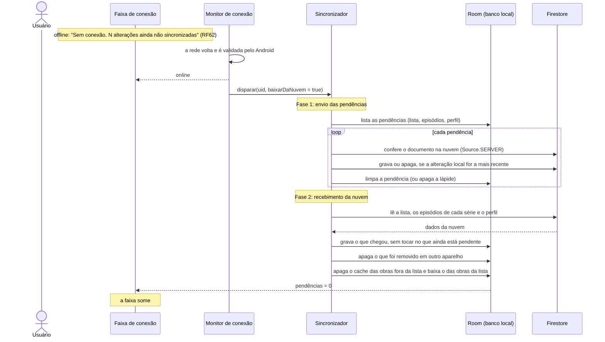
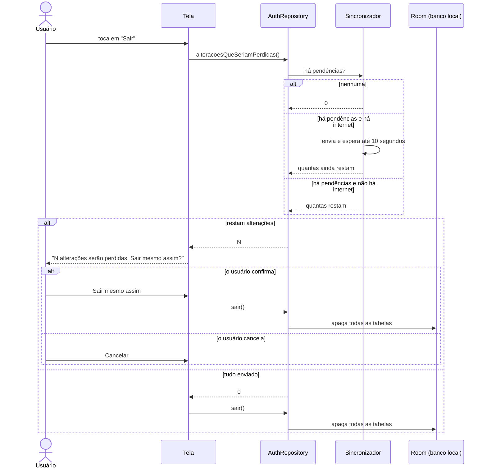
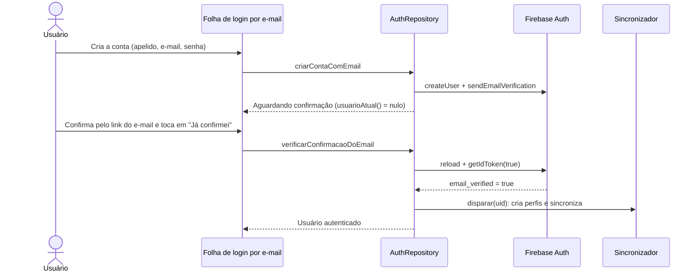

# Seriando — Diagrama de Sequência: alterações offline e sincronização (RF33, RF62)

Este documento descreve como uma alteração feita pelo usuário chega ao Firestore, com e sem internet,
e como o app reage quando a conexão volta. Relaciona-se às regras RN21 a RN25, RN27 e RN28 e à seção 4.1
do levantamento de requisitos.

## 1. Participantes

| Participante | Papel |
|---|---|
| Usuário | Quem usa o app |
| Tela | Tela Compose (por exemplo, Detalhes ou Minha Lista), que só conversa com o Repository |
| Repository | `MinhaListaRepository`, `ProgressoRepository` e `PerfilRepository`; leem e gravam no banco local |
| Room | Banco local do aparelho (tabelas `lista`, `episodiosAssistidos`, `perfil` e `obrasCache`) |
| Monitor | `MonitorConexao`, que informa se há internet |
| Sincronizador | `Sincronizador`, que envia as pendências e baixa os dados da nuvem em segundo plano |
| Firestore | Banco na nuvem |

## 2. Alteração feita pelo usuário (com ou sem internet)

A tela nunca espera o Firestore: sem conexão, uma gravação no Firestore só termina quando a internet volta,
e a tela ficaria travada. Por isso a tela só espera o Room, que responde na hora (RN21).

```mermaid
sequenceDiagram
    actor U as Usuário
    participant T as Tela
    participant R as Repository
    participant DB as Room (banco local)
    participant S as Sincronizador
    participant M as Monitor de conexão
    participant F as Firestore

    U->>T: marca um episódio como assistido
    T->>R: marcarAssistido(uid, série, temporada, episódio)
    R->>DB: grava o episódio (pendente = true, atualizadoEm = agora)
    DB-->>R: confirmado
    R->>S: disparar(uid, baixarDaNuvem = false)
    R-->>T: pronto
    T-->>U: episódio aparece marcado na hora

    S->>M: há internet?
    alt sem internet
        M-->>S: não
        Note over S: adia; a alteração continua pendente (RN22, RN28)
    else com internet
        M-->>S: sim
        S->>F: lê só o documento do episódio, para conferir conflito
        F-->>S: documento (ou ausente)
        alt a nuvem tem uma alteração mais recente
            Note over S: a nuvem vence (RN23)
            S->>DB: substitui o episódio local pelo da nuvem
        else a alteração local é a mais recente
            S->>F: grava (ou apaga) o episódio, com atualizadoEm
            F-->>S: confirmado
            S->>DB: limpa a marca de pendente (só se o item não mudou no meio)
        end
    end
```

Nota sobre o recebimento (RN41, RNF19): para cada série da lista, o Sincronizador lê só os episódios cujo `atualizadoEm` é maior que a última conferência guardada (menos 1 hora de margem de relógio), compara o total da nuvem (consulta de agregação) com o total local e, se divergirem, lê todos os episódios da série. Uma leitura completa também ocorre no máximo uma vez por semana. Detalhes e números em estrategia-de-requisicoes.md.

## 3. Volta da conexão

O monitor percebe a mudança de estado e pede uma sincronização completa: primeiro o envio de tudo
o que ficou pendente e depois o recebimento dos dados da nuvem (RN28).



## 4. Sair da conta (RN25, RN27)

Como o banco local é apagado no logout, antes de sair o app tenta enviar o que está pendente e, se
não conseguir, avisa quantas alterações seriam perdidas.



## 4.1 Entrar com e-mail e senha: por que o Sincronizador espera (RF32, RN33)

Uma conta de e-mail e senha recém-criada ainda não tem o e-mail confirmado. Nesse intervalo o app a trata como visitante e o Sincronizador não roda, porque as regras do Firestore também negam leitura e gravação sem `email_verified`.



## 5. Regras de conflito e limitações conhecidas

- **Gravação mais recente vence (RN23).** A comparação usa o campo `atualizadoEm`, que vem do relógio do
  celular; um relógio errado pode fazer uma alteração antiga vencer.
- **Documentos antigos da nuvem** não têm `atualizadoEm` e valem 0: perdem para qualquer alteração local.
- **Episódio desmarcado em outro aparelho** não deixa marca de data na nuvem (o documento some), então uma
  marcação local pendente sobre o mesmo episódio vence. É uma limitação aceita.
- **Chave da lista** é o id da TMDB: um filme e uma série com o mesmo id se sobrescreveriam na lista do mesmo usuário.
- **Leituras no Firestore:** o recebimento completo (uma consulta por série, mais a lista e o perfil) só roda
  ao abrir o app, no login e quando a internet volta, para limitar o número de leituras.
