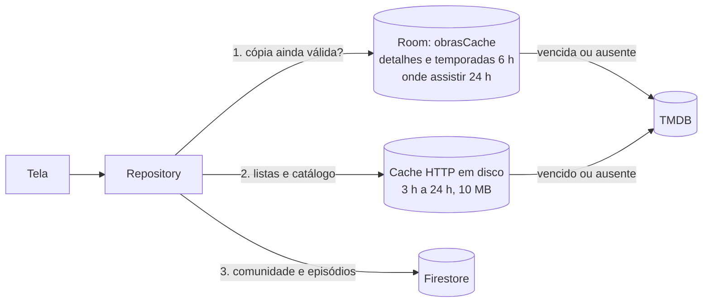

# Seriando — Estratégia de Requisições e Uso de Cotas (RNF13 e RNF19)

Versão de 26/10/2026. Explica **por que** o app foi ajustado para fazer menos chamadas à TMDB e menos leituras no Firestore, **o que** foi feito em cada camada, **quanto** isso economiza e **o que fazer** quando o número de usuários crescer. Complementa requisitos-seriando.md (RNF13, RNF19, RN39 a RN41), arquitetura.md, modelagem-banco.md e stride-seriando.md.

Os números deste documento são **estimativas por contagem de chamadas no código**, calculadas para o usuário de exemplo da seção 3. Não são medições em produção. Os limites externos foram conferidos nas páginas oficiais da TMDB e do Firebase em 26/10/2026 e podem mudar: vale conferi-los de novo antes de qualquer decisão de custo.

---

## 1. O problema em uma frase

O Seriando depende de dois serviços externos que limitam o uso, e o gasto desses limites cresce multiplicando três coisas: **usuários × aberturas por dia × chamadas por abertura**. Com poucos usuários nada disso aparece. Com muitos, o último fator decide se o app cabe no plano gratuito ou não. É o único dos três que o projeto controla, então foi ele que foi reduzido.

## 2. Os limites que existem

| Serviço | O que limita | Valor (conferido em 26/10/2026) | Como isso atinge o Seriando |
|---|---|---|---|
| TMDB | Taxa de requisições | Sem cota diária divulgada. A TMDB diz ter limites superiores "na faixa de 40 requisições por segundo", que "podem mudar a qualquer momento", e pede que o cliente respeite o erro 429 | Raro de atingir: as chamadas saem dos celulares dos usuários, espalhadas no tempo. O risco maior é o abuso da chave (ela vai dentro do APK) e a licença |
| TMDB | Licença | Gratuita para uso **não comercial**, com atribuição. O projeto é considerado comercial quando o objetivo principal é gerar receita (por exemplo, anúncios) | Qualquer monetização exige acordo comercial com a TMDB (ver a seção 8) |
| Firestore (plano gratuito, Spark) | Leituras por dia | 50.000 | **É o limite que mais pesa.** Vale para o projeto inteiro, somando todos os usuários |
| Firestore (plano gratuito) | Escritas e exclusões por dia | 20.000 de cada | Folgado: o app grava pouco |
| Firestore (plano gratuito) | Armazenamento e saída de dados | 1 GiB e 10 GiB por mês | Folgado |
| Firestore | Consultas de agregação (`count`, `average`) | Cobradas por entradas de índice lidas: 1 leitura a cada 1.000 entradas, no mínimo 1 | Muito mais barato que baixar os documentos |

Um ponto que muda a forma de pensar: a cota do Firestore é **compartilhada por todos os usuários**. Se ela acaba, o app para para todo mundo até o dia seguinte. Um único usuário com muitas séries, ou um programa abusivo, pode consumir a cota de todos. Por isso reduzir o gasto por usuário é uma questão de **disponibilidade**, e não só de custo (ver o STRIDE, ameaça D).

## 3. Onde o gasto estava e como ficou

Usuário de exemplo: logado, com 20 séries na lista e cerca de 50 episódios marcados em cada uma; abre o app 3 vezes por dia e abre 6 vezes a tela de Detalhes de uma obra com 30 opiniões (2 votos em média por opinião).

| Ação | Antes | Depois | Como |
|---|---|---|---|
| Abrir o app (sincronizar episódios) | ~1.022 leituras do Firestore (20 séries × 50 episódios, mais a lista e o perfil) | ~62 leituras (2 por série, mais a lista e o perfil) | Conferência por diferença (RN41) |
| Abrir a Home | ~26 chamadas à TMDB (21 das fileiras, mais até 5 de recomendações), a cada abertura | 0 enquanto o cache em disco valer (3 a 6 horas) | Cache HTTP em disco (RN39) |
| Abrir Detalhes (TMDB) | 2 chamadas por abertura (obra e "onde assistir") | 1 chamada na primeira vez e 0 nas seguintes, por 6 horas | `append_to_response` e cache no Room (RN39) |
| Abrir Detalhes (comunidade) | ~122 leituras: 30 da média, 30 da lista, 2 da sua opinião e ~60 dos votos | ~44 leituras: 1 da média, até 20 da primeira página, 2 da sua opinião, 1 das ocultas e ~20 dos votos | Agregação, paginação e votos só das opiniões exibidas (RN40) |
| Abrir Detalhes de uma obra com 300 opiniões | ~1.200 leituras | ~44 leituras | O custo deixa de crescer com o número de opiniões |

Por dia, por usuário ativo: cerca de **3.800 leituras antes** (3 × 1.022 + 6 × 122) e cerca de **450 depois** (3 × 62 + 6 × 44), uma redução de aproximadamente 8 vezes.

### 3.1 O que isso significa quando o app crescer

Leituras do Firestore por dia, com o mesmo usuário de exemplo, comparadas ao limite gratuito de 50.000:

| Usuários ativos por dia | Antes | Depois | Cabe no plano gratuito? |
|---|---|---|---|
| 10 | ~38 mil | ~4,5 mil | Antes sim; depois sim, com sobra |
| 50 | ~190 mil | ~22 mil | Antes não; depois sim |
| 100 | ~380 mil | ~45 mil | Antes não; depois no limite |
| 500 | ~1,9 milhão | ~225 mil | Nenhum dos dois: é preciso o plano pago (Blaze) |
| 1.000 | ~3,8 milhões | ~450 mil | Idem; o custo depois é cerca de 8 vezes menor que antes |

Leitura dos números: sem as medidas, o plano gratuito acabaria perto de 13 usuários ativos por dia. Com elas, perto de 110. Passando disso, o app precisa do plano pago, e a economia continua valendo: paga-se por leitura excedente, então gastar 8 vezes menos significa uma conta cerca de 8 vezes menor (a tabela de preços atual está em firebase.google.com/docs/firestore/pricing).

## 4. A ideia em quatro verbos

As medidas parecem muitas, mas todas seguem quatro ideias. Pensar nelas ajuda a decidir onde mexer quando surgir um gasto novo.

1. **Guardar.** Não pedir de novo o que já se sabe. Cópia no Room com validade para as obras, cache HTTP em disco para as listas da TMDB e cache em memória para a sessão.
2. **Reduzir.** Pedir menos do que antes. Média calculada no servidor, opiniões por páginas, votos só das opiniões visíveis e episódios por diferença.
3. **Juntar.** Fazer uma chamada em vez de várias. O "onde assistir" veio dentro da resposta da obra (`append_to_response`), junto com elenco, vídeos e classificação.
4. **Respeitar.** Obedecer ao serviço quando ele pede calma. Em caso de erro 429, o app espera e tenta de novo, em vez de insistir ou falhar na hora.

## 5. O que foi feito em cada camada

### 5.1 TMDB

| Medida | Onde fica no código | Regra |
|---|---|---|
| Elenco, vídeos, classificação **e "onde assistir"** na mesma chamada da obra | `TmdbApiService` (`append_to_response`), `SerieDetalhe` e `MovieDetalhe` | RN39 |
| Cópia das obras no Room com validade: detalhes e temporadas 6 horas, "onde assistir" 24 horas. Se a rede falhar, usa a cópia mesmo vencida (modo offline, RF33) | `ObraCacheRepository.comCache` | RN39 |
| Cache HTTP em disco (10 MB) para as listas: Em alta e Descobrir 3 horas, recomendações 6 horas, gêneros, streamings, pessoas e classificações 24 horas. Busca, detalhes e temporadas ficam de fora de propósito (o Room já cuida dos detalhes) | `RetrofitInstance` (interceptador de rede) | RN39 |
| "Puxar para atualizar" da Home esvazia o cache em disco, para o gesto sempre trazer dados novos | `HomeScreen`, `RetrofitInstance.limparCache` | RF82 |
| Em caso de erro 429, espera o tempo do cabeçalho `Retry-After` (ou 1 e 2 segundos) e tenta de novo, no máximo 2 vezes; se a espera passar de 5 segundos, trata como falha comum | `RetrofitInstance` (interceptador de aplicação) | RNF19 |

A chave do cache em disco é a URL completa. Por isso parâmetros diferentes (página, gênero, filtros) nunca se misturam, e só dados públicos da TMDB ficam guardados, nada do usuário. A idade do usuário (RF50) é aplicada depois, dentro do app, então o cache é igual para todos e o filtro continua correto.

### 5.2 Firestore

| Medida | Onde fica no código | Regra |
|---|---|---|
| Média e total das notas calculados pelo servidor (agregação `count` e `average`), sem baixar as avaliações | `AvaliacaoRepository.buscarMediaDaComunidade` | RN40 |
| Opiniões em páginas: a sua no topo e depois lotes de 20 documentos por data, com o botão "Carregar mais opiniões" | `AvaliacaoRepository.buscarPrimeiraPaginaDeOpinioes` e `buscarMaisOpinioes` | RN40 |
| Votos (curtidas e descurtidas) lidos só das opiniões que estão na tela | `DetailsScreen.carregarVotosFaltantes` | RN40 |
| Episódios por diferença: lê só o que mudou desde a última conferência e compara o total da nuvem com o local; só lê tudo se houver divergência, na primeira vez ou depois de 7 dias | `Sincronizador.receberEpisodiosPorDiferenca`, `EstadoDaSincronizacao` | RN41 |
| Gravações só enviam; o download da nuvem acontece na abertura do app, no login e na volta da conexão (decisão do Bloco N) | `Sincronizador` | RN28 |

## 6. Decisões conscientes: o que foi escolhido e o que ficou de fora

| Alternativa | Decisão | Motivo |
|---|---|---|
| Contadores de curtidas e descurtidas gravados no documento da opinião | **Adiada** | Sem Cloud Functions, quem soma é o próprio app, e as regras teriam de validar que cada voto mexe só em +1 ou -1, o que é frágil. Hoje o custo já é limitado pela paginação. Torna-se prioridade quando houver opiniões em volume |
| Cloud Functions (contadores, limpeza de dados, proxy da TMDB) | **Adiada** | Exige o plano pago do Firebase |
| Firebase App Check | **Adiado** | O provedor gratuito do Android (Play Integrity) depende do app ser reconhecido pela Play Store; num APK instalado fora dela, o App Check poderia bloquear o próprio app |
| Escutas em tempo real (listeners) para as opiniões | **Descartada** | Cada mudança de um documento é cobrada como leitura para quem está ouvindo, o que aumenta o gasto em vez de reduzi-lo |
| Sincronização em segundo plano com WorkManager | **Adiada** | Faria leituras também nos horários em que o usuário nem está usando o app; hoje a sincronização acontece só quando ele abre o app, faz login ou a internet volta |
| Espera de digitação (debounce) na busca | **Não necessária** | A busca já é disparada apenas pelo botão de pesquisar do teclado, e há proteção contra toques repetidos |
| Mostrar a Home com dados vencidos quando estiver sem internet | **Não feita** | Mudaria o comportamento aprovado do modo offline (RN24): Home, busca e comunidade só mostram o aviso |
| Exclusão de conta filtrada por autor | **Adiada** | A rotina também percorre todas as opiniões para achar os votos do usuário; resolver exigiria gravar o uid do votante em cada voto, mudar as regras e criar um índice. Para a escala atual o custo (uma vez por conta excluída) é aceitável |

## 7. Limitações conhecidas

| Limitação | Efeito | Por que se aceita |
|---|---|---|
| Os dados da TMDB podem ficar defasados pelo tempo de validade (até 6 horas nas obras, 3 horas nas listas) | Um episódio novo ou a nota da TMDB podem demorar a aparecer | É a troca direta entre frescor e economia; as validades são constantes fáceis de ajustar (`ObraCacheRepository` e `RetrofitInstance`) |
| A conferência por diferença usa o `atualizadoEm`, que vem do relógio do celular (a mesma limitação de RN23) | Dois aparelhos com relógios muito diferentes, e alterações que se compensam (um marca e o outro desmarca), podem manter uma diferença até a próxima leitura completa | A margem de 1 hora cobre relógios comuns; a leitura completa obrigatória a cada 7 dias limita o tempo da diferença |
| A média e a contagem por agregação exigem internet | Sem conexão, a seção de comunidade mostra o aviso | A comunidade já é só online (RN24) |
| A paginação continua do ponto onde parou usando a data da última opinião lida | Duas opiniões gravadas no mesmo milissegundo, exatamente na fronteira entre duas páginas, poderiam ser puladas | Probabilidade desprezível; um cursor por documento resolveria, com mais complexidade |
| O cache em disco só funciona depois de iniciado em `SeriandoApp` | Nenhum, na prática; sem ele o app funciona normalmente, só sem guardar respostas | Falha segura |

## 8. Evolução quando o app crescer

Cada linha tem um **gatilho** (o sinal de que é hora) e a **ação** correspondente, em ordem aproximada de prioridade.

| Gatilho | Ação | Observação |
|---|---|---|
| As leituras do dia se aproximam de 50.000 no painel do Firebase (cerca de 100 usuários ativos por dia, pela estimativa) | Passar para o plano Blaze, com **alerta de orçamento** configurado | A conta cresce de forma proporcional ao uso; as medidas deste documento a mantêm baixa |
| Obras com centenas de opiniões e votos | Gravar os contadores de curtidas e descurtidas no documento da opinião, mantidos por Cloud Function (ou por transação com regras estritas) | Reduz a leitura de votos a 1 por opinião exibida |
| Publicação na Play Store | Ativar o **App Check** com Play Integrity e restringir a chave da API do Firebase ao pacote e à impressão digital do app | Protege a cota contra uso por programas que não são o app |
| Uso comercial (anúncios ou venda) | Obter a **licença comercial da TMDB** e colocar um servidor intermediário (Cloud Functions ou Cloud Run) entre o app e a TMDB, com cache central e a chave fora do APK | Atende aos termos da TMDB e protege a chave; o cache central serve a todos os usuários com uma só chamada |
| Exclusão de conta lenta | Gravar `votanteUid` em cada voto, criar o índice de grupo de coleção e filtrar por autor, ou mover a rotina para uma Cloud Function | Remove a varredura de todas as opiniões |
| Pedido de notificações de novos episódios | WorkManager, com o campo `next_episode_to_air` da TMDB e lotes por série | Maior item da lista de sugestões; planejar o custo junto |

## 9. Como acompanhar o uso

1. **Firebase Console, Firestore, aba Uso:** gráfico diário de leituras, escritas e exclusões, para comparar com as cotas.
2. **Alertas de orçamento** (necessários no plano Blaze), para ser avisado antes de gastar.
3. **Logcat, etiqueta `Sincronizador`:** mostra, para cada série, se a conferência foi por diferença ou leitura completa, e quantos episódios mudaram.
4. **Roteiro de teste das medidas:** abrir uma obra duas vezes seguidas (a segunda não deve chamar a TMDB), reabrir o app (a Home deve abrir do cache), puxar a Home para atualizar (deve buscar de novo), apagar um episódio no console (a série deve ler tudo e corrigir o aparelho).
