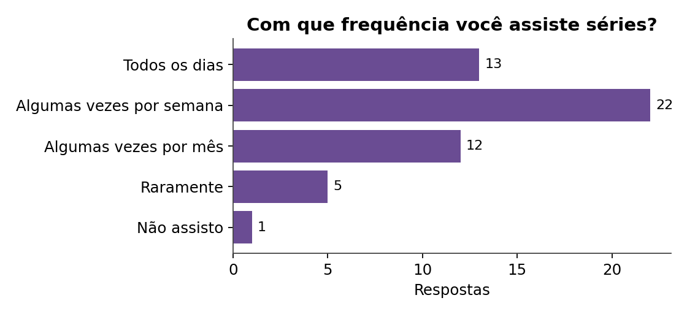
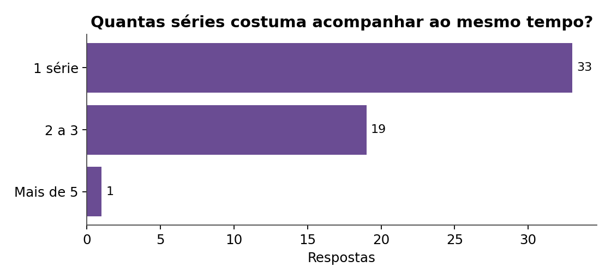
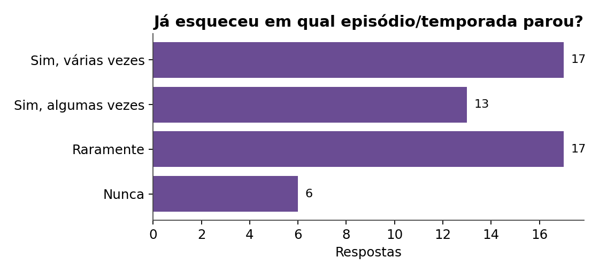
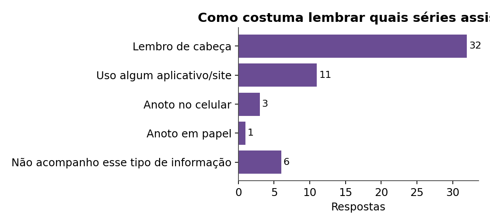
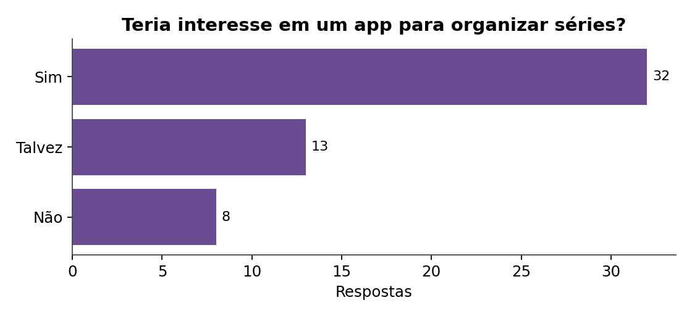
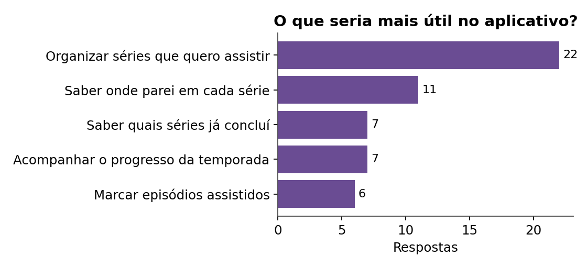

# Seriando — Estudo de Viabilidade

## 1. Objetivo e metodologia

Antes de definir o escopo do Seriando, a equipe aplicou uma pesquisa para validar se o problema que o app se propõe a resolver — organizar séries e filmes e lembrar onde o usuário parou — é um problema real, e não apenas uma suposição.

A pesquisa foi aplicada por formulário (Google Forms), com divulgação aberta, e obteve **53 respostas**. As perguntas combinaram questões fechadas (para medir comportamento e interesse) e uma questão aberta (para captar necessidades que a equipe não havia antecipado).

## 2. Resultados

### 2.1 Frequência de consumo de séries

A maioria dos respondentes assiste séries com frequência alta: 22 algumas vezes por semana e 13 todos os dias — 35 das 53 respostas (66%) assistem com frequência semanal ou maior. O público-alvo do app é, portanto, um público ativo, não ocasional.

### 2.2 Quantidade de séries acompanhadas ao mesmo tempo

33 respondentes acompanham 1 série por vez, 19 acompanham de 2 a 3. Isso indica que, mesmo para quem assiste pouca coisa simultânea, perder o fio da meada é um problema — não é um recurso só para quem acompanha dezenas de séries ao mesmo tempo.

### 2.3 Já esqueceu onde parou?

30 das 53 respostas (57%) relatam já ter esquecido em qual episódio ou temporada pararam "várias vezes" ou "algumas vezes". Esse é o dado central do estudo: confirma que a dor que motiva o RF10 (acompanhar o progresso da série) é real e frequente.

### 2.4 Como costuma lembrar quais séries assiste

32 respondentes (60%) ainda "lembram de cabeça", sem nenhuma ferramenta. Apenas 11 já usam algum aplicativo ou site para isso. Combinado com o resultado da pergunta anterior, isso mostra uma lacuna clara: a maioria depende da própria memória para resolver um problema que a própria pesquisa mostra que falha com frequência.

### 2.5 Interesse em um aplicativo como o Seriando

32 responderam "Sim" e 13 "Talvez" — 85% das respostas demonstram algum nível de interesse em um app com essa proposta, validando a decisão de seguir com o projeto.

### 2.6 O que seria mais útil no aplicativo

"Organizar séries que quero assistir" foi a opção mais citada (22), seguida de "saber onde parei em cada série" (11). Essas duas respostas, somadas, justificam a prioridade dada a RF07 (lista pessoal) e RF10 (progresso) no levantamento de requisitos.

## 3. Principais temas da pergunta aberta

A pergunta "O que você acha que não poderia faltar em um aplicativo desse tipo?" foi de resposta livre. As respostas foram agrupadas por tema recorrente:

| Tema                                    | Exemplo de resposta                                                            |
| --------------------------------------- | ------------------------------------------------------------------------------ |
| Progresso / onde parou                  | "Controle de onde parou de assistir"                                           |
| Organização geral da lista              | "Uma forma simples de organizar as séries e marcar os episódios já assistidos" |
| Recomendação de séries parecidas        | "Recomendação baseada nas séries já assistidas"                                |
| Avaliação / nota                        | "Classificação de quanto gostou da série, como 2 ou 4 estrelas"                |
| Classificação por gênero                | "A classificação do tipo de série como drama, comédia entre outros"            |
| Integração com plataformas de streaming | "Linkar com as plataformas de streaming e ter todas elas em um só lugar"       |
| Sem anúncios                            | "Que não tenha anúncios"                                                       |

O tema de **recomendação de séries parecidas** apareceu com destaque e não corresponde a nenhum requisito já levantado — foi registrado como sugestão para uma versão futura do app (seção 4), já que incluí-lo agora estenderia o escopo além do cronograma definido.

## 4. Da pesquisa para os requisitos

| Achado da pesquisa                                               | Requisito correspondente                                                   |
| ---------------------------------------------------------------- | -------------------------------------------------------------------------- |
| 57% já esqueceram onde pararam                                   | RF09 (marcar episódios assistidos), RF10 (acompanhar progresso)            |
| "Organizar séries que quero assistir" foi a resposta mais citada | RF07 (adicionar/remover da lista pessoal), RF08 (status de acompanhamento) |
| Pedido por avaliação com estrelas                                | RF16 a RF18 (avaliação por estrelas e média da comunidade)                 |
| Pedido por classificação por gênero                              | RF44 (categorias por gênero na Home)                                       |
| Pedido por integração com plataformas de streaming               | RF34 (onde assistir — streaming disponível no Brasil)                      |
| Pedido por recomendação de séries parecidas                      | Não incluído no escopo atual — registrado como sugestão para versão futura |

Essa tabela é a evidência de que o levantamento de requisitos do Seriando não partiu apenas da visão da equipe, mas de necessidades relatadas por usuários reais em uma pesquisa aplicada antes do início do desenvolvimento.
