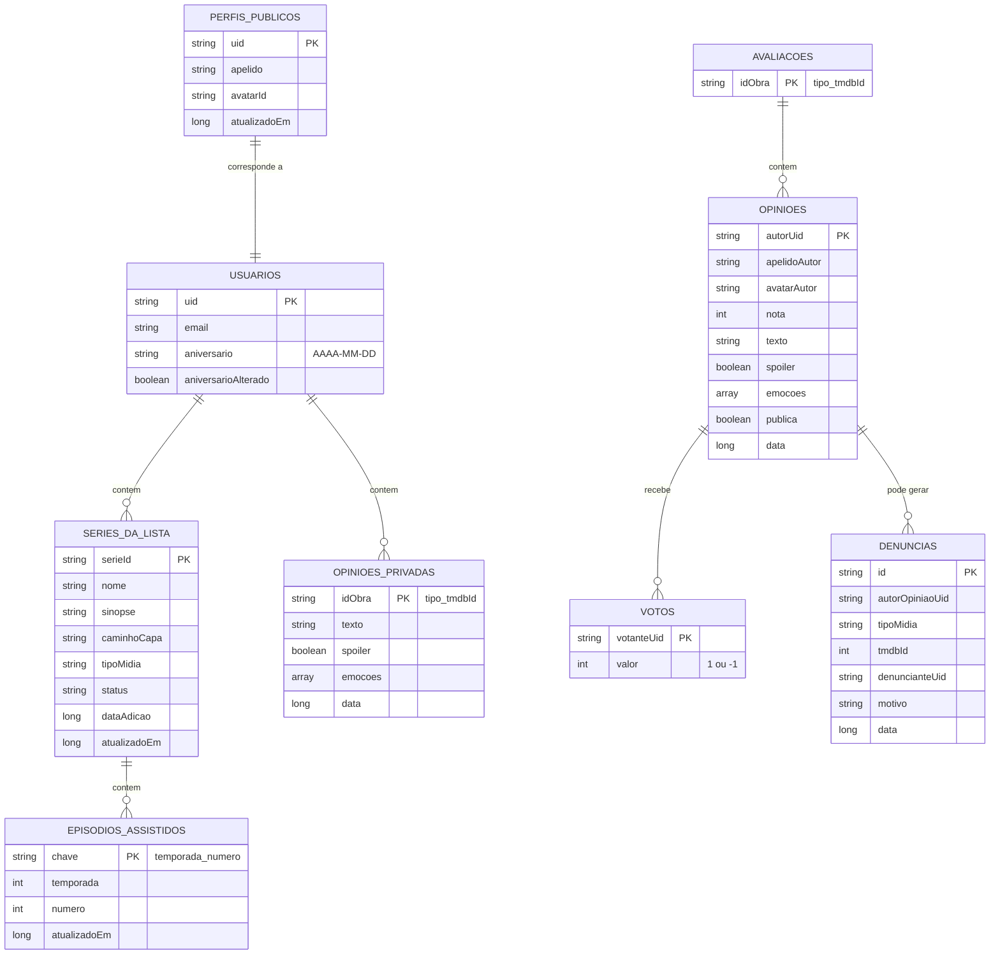
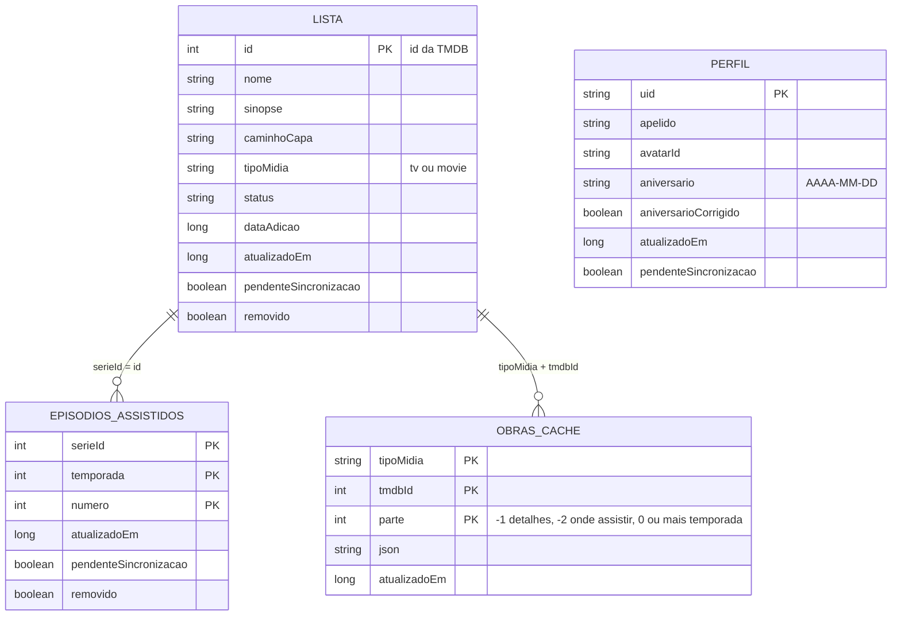

# Seriando — Modelagem do Banco de Dados (Cloud Firestore)

## 1. Por que não há MER/DER tradicional

O Firestore é um banco NoSQL orientado a documentos: não existem tabelas, chaves estrangeiras nem junções (JOIN). Por isso, este documento substitui o MER/DER e os scripts DDL/DML por equivalentes adequados ao modelo:

| Modelo relacional | Equivalente no Seriando (Firestore) |
|---|---|
| DER (diagrama entidade-relacionamento) | Diagrama de coleções e documentos (seção 2) |
| DDL (estrutura das tabelas) | Tabela de campos e tipos de cada documento (seção 3) |
| DML (exemplos de INSERT/SELECT) | Exemplos de leitura e escrita via repositórios Kotlin (seção 4) |

## 2. Diagrama de coleções e documentos



## 3. Estrutura de cada coleção (equivalente ao DDL)

### 3.1 `usuarios/{uid}` — dados privados

| Campo | Tipo | Observações |
|---|---|---|
| `email` | string | Vindo da conta Google no primeiro login |
| `aniversario` | string ou null | Data de nascimento completa no formato `AAAA-MM-DD` (RF59). Usada só para calcular a idade (RN13) e para o controle de idade (Bloco K); a idade em si não é guardada. Valores antigos em texto livre (como "15/03") são tratados como data inválida e o usuário vira menor até informar a data (RN16) |
| `aniversarioAlterado` | boolean | `true` depois que a data foi corrigida pela única vez permitida (RN17). As regras do Firestore recusam uma nova alteração da data quando este campo já é `true` |

A data pode ser definida uma vez e corrigida uma única vez. Depois disso, as regras de segurança impedem qualquer mudança (ver seção 5).

Subcoleções: `usuarios/{uid}/series/{serieId}` (3.3) e `usuarios/{uid}/opinioesPrivadas/{tipoMidia_tmdbId}` (3.6).

### 3.2 `perfisPublicos/{uid}` — dados públicos

| Campo | Tipo | Observações |
|---|---|---|
| `apelido` | string | Sugerido do primeiro nome da conta Google; editável |
| `avatarId` | string | `"google"` (usa a foto da conta) ou `"foto_01"` a `"foto_11"` (uma das 11 imagens de avatar do app, RF78). Valores antigos em emoji são aceitos pelas regras, mas o app mostra a inicial do apelido no lugar deles |
| `atualizadoEm` | long | Instante da última alteração do perfil, em milissegundos; vale para o perfil inteiro (inclui a data de nascimento de `usuarios/{uid}`) e resolve conflitos pela gravação mais recente (RN23) |

### 3.3 `usuarios/{uid}/series/{serieId}` — lista pessoal

| Campo | Tipo | Observações |
|---|---|---|
| `id` | int | ID da obra na TMDB |
| `nome` | string | |
| `sinopse` | string | |
| `caminhoCapa` | string ou null | Caminho relativo da capa na TMDB |
| `tipoMidia` | string | `"tv"` ou `"movie"` |
| `status` | string | Nome do enum `StatusSerie` ou `StatusFilme`, conforme `tipoMidia` |
| `dataAdicao` | long | Timestamp em milissegundos |
| `atualizadoEm` | long | Instante da última alteração, em milissegundos (RN23). Documentos antigos não têm o campo e valem 0 |

Subcoleção: `usuarios/{uid}/series/{serieId}/episodiosAssistidos/{temporada_numero}`

| Campo | Tipo | Observações |
|---|---|---|
| `temporada` | int | |
| `numero` | int | Número do episódio dentro da temporada |
| `dataAssistido` | long | Timestamp em milissegundos |
| `atualizadoEm` | long | Instante da marcação, em milissegundos (RN23). O app grava `temporada`, `numero` e `atualizadoEm`; documentos antigos podem ter `dataAssistido` |

### 3.4 `avaliacoes/{tipoMidia_tmdbId}/opinioes/{autorUid}` — avaliação e opinião

Um único documento por usuário por obra (RN01) reúne nota e opinião pública.

| Campo | Tipo | Observações |
|---|---|---|
| `autorUid` | string | |
| `apelidoAutor` | string | Denormalizado, evita buscar o perfil do autor a cada listagem |
| `avatarAutor` | string | Idem |
| `nota` | int | 1 a 5 (RN02); 0 = sem nota |
| `texto` | string | Até 500 caracteres (RN03) |
| `spoiler` | boolean | |
| `emocoes` | array\<string\> | Até 6 ids de `EMOCOES_DISPONIVEIS` (RN10) |
| `publica` | boolean | `true` neste documento; a opinião privada fica em `usuarios/{uid}/opinioesPrivadas` (3.6) |
| `data` | long | Timestamp em milissegundos |

Subcoleção: `avaliacoes/{tipoMidia_tmdbId}/opinioes/{autorUid}/votos/{votanteUid}`

| Campo | Tipo | Observações |
|---|---|---|
| `valor` | int | `1` (curtir) ou `-1` (descurtir), RN05 |

### 3.5 `denuncias/{id}` — moderação

| Campo | Tipo | Observações |
|---|---|---|
| `autorOpiniaoUid` | string | Quem escreveu a opinião denunciada |
| `tipoMidia` | string | |
| `tmdbId` | int | |
| `denuncianteUid` | string | Quem denunciou |
| `motivo` | string | Um dos valores fixos de `MOTIVOS_DENUNCIA` |
| `data` | long | Timestamp em milissegundos |

Leitura restrita a um futuro painel de moderação — o app cliente nunca lê esta coleção, só grava (RNF03).

### 3.6 `usuarios/{uid}/opinioesPrivadas/{tipoMidia_tmdbId}` — opinião privada

Guarda a opinião marcada como privada (RF48, RN12), fora de `avaliacoes/`, para que as regras do Firestore a mostrem só ao dono. A nota em estrelas fica sempre no documento público.

| Campo | Tipo | Observações |
|---|---|---|
| `autorUid` | string | Sempre o dono do documento |
| `apelidoAutor`, `avatarAutor` | string | Cópia do perfil no momento da gravação |
| `texto` | string | Até 500 caracteres (RN03) |
| `spoiler` | boolean | |
| `emocoes` | array\<string\> | Até 6 (RN10) |
| `publica` | boolean | Sempre `false` neste documento |
| `data` | long | Timestamp em milissegundos |

## 4. Exemplos de leitura e escrita (equivalente ao DML)

> Desde o Bloco N (modo offline), as telas da lista, do progresso e do perfil não chamam mais o Firestore diretamente: leem e gravam no banco local (seção 6) e o `Sincronizador` envia ao Firestore. Os exemplos abaixo mostram a forma original de acesso ao Firestore, que continua valendo para a comunidade (avaliações, votos e denúncias) e é o que o `Sincronizador` executa por baixo.

Escrita (equivalente a um INSERT/UPDATE):

```kotlin
// MinhaListaRepository.kt
suspend fun adicionarSerie(uid: String, serie: SerieSalva) {
    db.collection("usuarios").document(uid)
        .collection("series").document(serie.id.toString())
        .set(serie)
        .await()
}
```

Leitura de uma coleção inteira (equivalente a um SELECT * com filtro):

```kotlin
// AvaliacaoRepository.kt
suspend fun buscarOpinioes(tipoMidia: String, tmdbId: Int, uidAtual: String?): List<Avaliacao> {
    return buscarTodasAvaliacoes(tipoMidia, tmdbId)
        .filter { it.texto.isNotBlank() && (it.publica || it.autorUid == uidAtual) }
        .sortedByDescending { it.data }
}
```

Atualização de um campo específico (equivalente a um UPDATE parcial):

```kotlin
// MinhaListaRepository.kt
suspend fun atualizarStatusTexto(uid: String, serieId: Int, nomeStatus: String) {
    db.collection("usuarios").document(uid)
        .collection("series").document(serieId.toString())
        .update("status", nomeStatus)
        .await()
}
```

Exemplo ilustrativo da gravação da data de nascimento com a marca da correção única (RN17); a implementação real está no envio do perfil do `Sincronizador`:

```kotlin
// Exemplo ilustrativo (Sincronizador, envio do perfil)
db.collection("usuarios").document(uid)
    .set(
        mapOf(
            "aniversario" to dataAAAAMMDD,          // texto no formato AAAA-MM-DD
            "aniversarioAlterado" to jaFoiCorrigida  // true depois da única correção
        ),
        SetOptions.merge()
    )
    .await()
```

Remoção (equivalente a um DELETE):

```kotlin
// MinhaListaRepository.kt
suspend fun removerSerie(uid: String, serieId: Int) {
    db.collection("usuarios").document(uid)
        .collection("series").document(serieId.toString())
        .delete()
        .await()
}
```

## 5. Observação sobre regras de segurança

As regras de segurança definitivas estão publicadas no Firebase e versionadas no arquivo `firestore.rules` do repositório: cada usuário só lê e escreve a própria subárvore, as notas e opiniões públicas são legíveis por qualquer usuário autenticado, as opiniões privadas só pelo dono, cada voto só pelo próprio votante (e nunca na própria opinião) e a coleção `denuncias` é somente-escrita para o app. Os campos de cada documento são validados (tipos, tamanhos e valores permitidos).

Em `usuarios/{uid}`, as regras também validam a data de nascimento e a trava de correção (RN17): a data só pode ser corrigida uma vez, controlada pelo campo `aniversarioAlterado`; depois da correção, a data não muda mais. Confira o texto exato no arquivo `firestore.rules`. Essa trava protege o controle de idade contra troca repetida da data, mas não contra uma data falsa informada de início (a data não é verificada). O modelo de ameaças (STRIDE) detalha as limitações conhecidas.

## 6. Banco local (Room) — modo offline

O Room (SQLite no aparelho) espelha os dados pessoais do usuário logado e é de onde as telas leem (RN21). O Firestore não ganha coleções por causa dele: o `Sincronizador` converte as linhas locais nos documentos descritos na seção 3 e vice-versa. O arquivo do banco é `seriando.db`, na versão 1 e sem migração: mudanças de schema exigem desinstalar o app no desenvolvimento, e uma migração será obrigatória antes da publicação.



### 6.1 Tabelas e correspondência com o Firestore

| Tabela local | Documento(s) no Firestore | Observações |
|---|---|---|
| `lista` | `usuarios/{uid}/series/{id}` | A chave é o id da TMDB, igual ao id do documento (limitação conhecida: um filme e uma série com o mesmo id da TMDB se sobrescreveriam) |
| `episodiosAssistidos` | `usuarios/{uid}/series/{id}/episodiosAssistidos/{temporada_numero}` | |
| `perfil` | `perfisPublicos/{uid}` (apelido, avatar, `atualizadoEm`) e `usuarios/{uid}` (data de nascimento, `aniversarioAlterado` e e-mail) | Uma linha por usuário. `aniversarioCorrigido` é o equivalente local de `aniversarioAlterado`. O e-mail não é guardado localmente (coleta mínima, RNF08): vem do login |
| `obrasCache` | — (só existe no aparelho) | Cópia das respostas da TMDB das obras da lista, em JSON, para consultar sem internet (RNF13). Nunca vai ao Firestore |

Dados que ficam fora do Room e do Firestore, só no aparelho: a indicação de "introdução já vista" (DataStore, RN30) e o histórico de busca (SharedPreferences, RN29). A classificação indicativa das obras é consultada na TMDB e guardada apenas em memória durante o uso (controle de idade); não vai para nenhum dos dois bancos.

### 6.2 Campos de controle da sincronização

- `pendenteSincronizacao`: `true` enquanto a alteração não foi confirmada na nuvem (RN22).
- `atualizadoEm`: instante da última alteração, em milissegundos; a gravação mais recente vence (RN23).
- `removido`: lápide. Remover sem conexão marca a linha como removida e pendente; ela some da tela, e só é apagada depois de a exclusão chegar à nuvem.
- `aniversarioCorrigido`: `true` depois da correção única da data de nascimento (RN17).
- Confirmar o envio só limpa a marca de pendente se o `atualizadoEm` ainda for o mesmo que foi enviado; assim, uma alteração feita durante o envio não se perde.

### 6.3 Exemplos de consulta (DAOs do Room)

```kotlin
// ListaDao: a lista que a tela mostra, sem os itens marcados como removidos (Flow: a tela atualiza sozinha)
@Query("SELECT * FROM lista WHERE removido = 0 ORDER BY dataAdicao DESC")
fun observarItens(): Flow<List<ListaEntity>>

// ListaDao: remove da tela na hora e deixa a lápide para o envio à nuvem
@Query("UPDATE lista SET removido = 1, pendenteSincronizacao = 1, atualizadoEm = :agora WHERE id = :id")
suspend fun marcarRemovido(id: Int, agora: Long)

// ListaDao: confirma o envio só se o item não mudou desde então
@Query("UPDATE lista SET pendenteSincronizacao = 0 WHERE id = :id AND atualizadoEm = :atualizadoEm")
suspend fun marcarSincronizado(id: Int, atualizadoEm: Long)

// ObraCacheDao: apaga a cópia das obras que não estão mais na lista
@Query("DELETE FROM obrasCache WHERE NOT EXISTS (SELECT 1 FROM lista WHERE lista.id = obrasCache.tmdbId AND lista.tipoMidia = obrasCache.tipoMidia AND lista.removido = 0)")
suspend fun apagarForaDaLista()
```

### 6.4 Ciclo de vida do banco local (RN25)

O banco guarda dados apenas do usuário logado: é apagado por completo no logout e na exclusão de conta. O app também registra de quem é o banco (preferência `dono_do_banco_local`) e o apaga no login se encontrar dados de outro usuário. Ao entrar, sair ou receber da nuvem uma data de nascimento diferente, a `VersaoDaIdade` é atualizada e as listas em memória são recarregadas (RN32).
